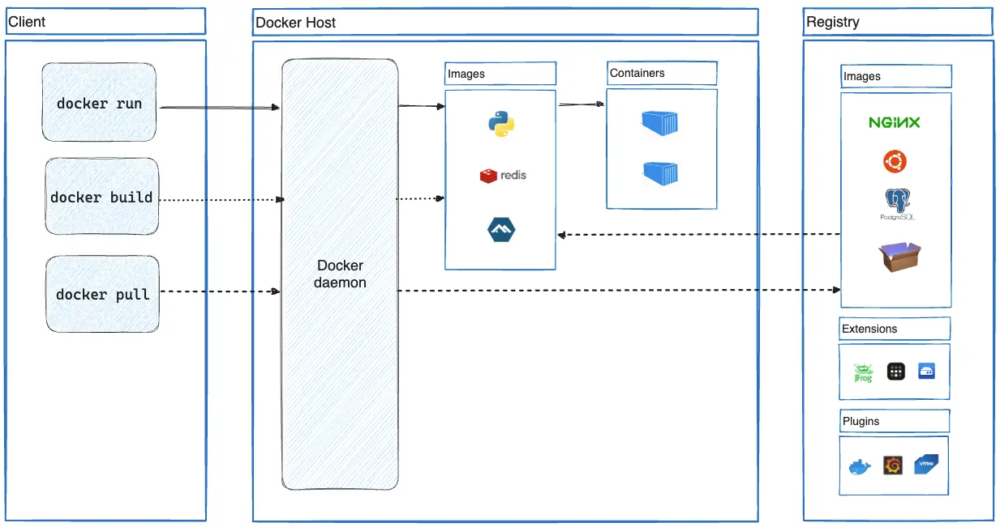
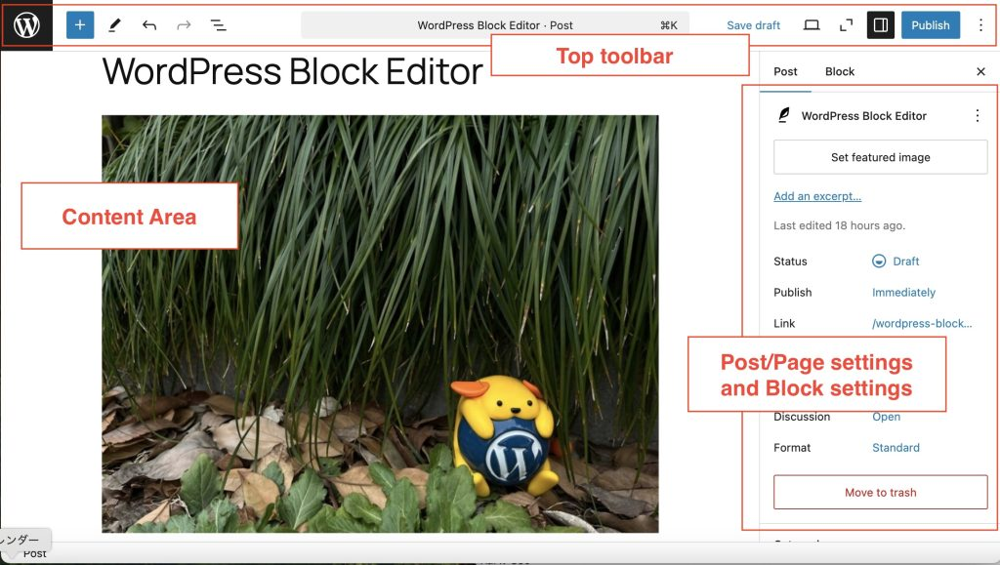
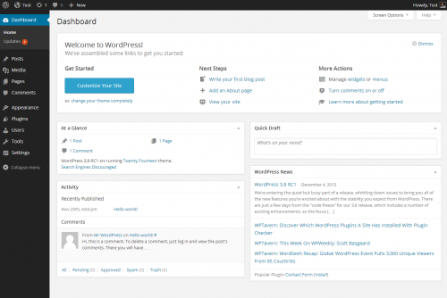

<!-- _class: cover -->

<span class="week">Week 1</span>

# WordPress op de eigen server

Van browser tot database

**Mijlpaal:** werkende site op de LXC, bereikbaar vanaf een tweede toestel.

<figure class="visual">

<figcaption>Beeld: <a href="https://store.steampowered.com/app/620/">Portal 2, Valve, via Steam</a></figcaption>
</figure>

<!-- Beeldbron: Portal 2, Valve, via Steam. https://shared.akamai.steamstatic.com/store_item_assets/steam/apps/620/ss_f3f6787d74739d3b2ec8a484b5c994b3d31ef325.1920x1080.jpg?t=1790187113. Geraadpleegd op 2026-10-30. Volledige brongegevens: ../assets/slides/BRONNEN.md -->


---

<!-- _class: lesson -->

# Wat je vandaag leert

Je zet een eerste WordPress-site op de eigen LXC en controleert of iemand anders haar kan openen.

- Je legt uit wat WordPress en MariaDB elk doen en waar ze gegevens bewaren.
- Je start de containers met Docker Compose en leest hun status.
- Je maakt een testbericht en controleert dat het na containerheraanmaak nog bestaat.

**Vertrekpunt:** de opleiding heeft Docker en Compose op je LXC klaargezet.

---

<!-- _class: visual lesson -->

# Ons voorbeeld: PixelAtlas

PixelAtlas helpt bezoekers een game kiezen. Home introduceert de gids, de catalogus toont meerdere games en de detailpagina beschrijft één game.

We gebruiken dit voorbeeld om alle weken te verbinden. Bij een receptenplatform krijg je dezelfde route: Home, receptenlijst en één recept. Je eigen onderwerp mag dus verschillen.

<figure class="visual">

<figcaption>Beeld: <a href="../Opdracht/docker/README.md">Eigen cursusvoorbeeld PixelAtlas. Gamebeelden: oorspronkelijke makers, via Steam</a></figcaption>
</figure>

<!-- Beeldbron: Eigen cursusvoorbeeld PixelAtlas. Gamebeelden: oorspronkelijke makers, via Steam. ../../Opdracht/docker/README.md. Geraadpleegd op 2026-10-30. Volledige brongegevens: ../assets/slides/BRONNEN.md -->


---

<!-- _class: lesson -->

# Wat doet een CMS?

Een **contentmanagementsysteem** bewaart en beheert inhoud. Je schrijft bijvoorbeeld een gamebeschrijving in WordPress en publiceert die zonder zelf een volledig HTML-bestand te maken.

Het thema bepaalt hoe de beschrijving verschijnt. Verander je de gedeelde opmaak van gamepagina's, dan kunnen alle items dezelfde nieuwe vormgeving krijgen.

**Voorbeeld:** de studio en beschrijving van Hades blijven bewaard wanneer je een ander lettertype kiest.

---

<!-- _class: compact lesson -->

# Inhoud, presentatie en functie

De site combineert gegevens met regels voor weergave en gedrag. Die onderdelen hebben elk een eigen plaats.

| Onderdeel | Voorbeeld in PixelAtlas | Waar beheer je dat? |
| --- | --- | --- |
| Inhoud | Titel en beschrijving van Hades | In een inhoudsitem |
| Presentatie | Kleuren en indeling van de detailpagina | In het thema |
| Functie | Zoeken, velden of een review indienen | Via WordPress en plug-ins |

Houd het inhoudsmodel beschikbaar wanneer je de vormgeving verandert.

---

<!-- _class: lesson -->

# Pagina, bericht en eigen contenttype

WordPress biedt verschillende soorten inhoud. Kies de soort op basis van wat één item voorstelt.

- Een **pagina** bevat vaste informatie, zoals Home of Over.
- Een **bericht** past in een publicatiestroom, zoals nieuws over nieuwe releases.
- Een **eigen contenttype** verzamelt een apart soort items, bijvoorbeeld Games met hun kenmerken.

Vandaag verken je pagina's en berichten. In week 3 bouw je het eigen contenttype voor je catalogus.

---

<!-- _class: lesson -->

# Zes weken aan dezelfde site werken

Je bouwt vanaf week 1 op de **uiteindelijke LXC**. De inhoud en instellingen van deze week vormen dus de basis voor de volgende weken.

Elke week heeft maximaal één uur theorie en demonstratie. Daarna pas je de stappen toe op je eigen project.

De route loopt van installatie en ontwerp naar een catalogus, interactie, herstel en oplevering. Bewaar onderweg code en korte testnotities zodat je keuzes later kunt uitleggen.

---

<!-- _class: lesson -->

# De site openen via het LXC-adres

Je hebt voor deze opdracht geen domeinnaam nodig. Open in de browser `http://<LXC-IP>:8080` en vervang `<LXC-IP>` door het toegewezen IP-adres.

Bij `http://192.168.1.50:8080` is het IP-adres de bestemming en `8080` de gepubliceerde webpoort. Dit adres is alleen een voorbeeld.

**HTTP versleutelt de verbinding niet.** Gebruik op deze interne oefensite uitsluitend testaccounts, fictieve reacties en aparte testwachtwoorden.

---

<!-- _class: visual lesson -->

# Wat gebeurt er bij een paginabezoek?

De browser stuurt een HTTP-verzoek naar de LXC op poort 8080. WordPress verwerkt het verzoek, leest waar nodig gegevens uit MariaDB en stuurt een webpagina terug.

De browser toont het antwoord. Hij maakt zelf geen rechtstreekse verbinding met de database. De figuur toont dat algemene verzoek-antwoordprincipe.

<figure class="visual">

<figcaption>Beeld: <a href="https://developer.mozilla.org/en-US/docs/Learn_web_development/Getting_started/Web_standards/How_the_web_works">MDN Web Docs-bijdragers</a></figcaption>
</figure>

<!-- Beeldbron: MDN Web Docs-bijdragers. https://developer.mozilla.org/en-US/docs/Learn_web_development/Getting_started/Web_standards/How_the_web_works/simple-client-server.png. Geraadpleegd op 2026-10-30. Volledige brongegevens: ../assets/slides/BRONNEN.md -->


---

<!-- _class: visual lesson -->

# Twee services onder Docker Compose

Compose leest de beschrijving in `compose.yaml` en beheert onze twee services.

**wordpress** voert Apache, PHP en WordPress uit en beantwoordt webverzoeken. **db** voert MariaDB uit en bewaart onder meer inhoud en instellingen.

De Docker-figuur toont hoe de client containers beheert. In onze opstelling draaien beide services op dezelfde LXC.

<figure class="visual">

<figcaption>Beeld: <a href="https://docs.docker.com/get-started/docker-overview/">Docker, Inc.</a></figcaption>
</figure>

<!-- Beeldbron: Docker, Inc.. https://docs.docker.com/get-started/images/docker-architecture.webp. Geraadpleegd op 2026-10-30. Volledige brongegevens: ../assets/slides/BRONNEN.md -->


---

<!-- _class: lesson -->

# Waarom is de databasehost `db`?

Compose maakt een intern netwerk waarop services elkaar via hun servicenaam vinden. Daarom gebruikt WordPress `WORDPRESS_DB_HOST: db:3306`.

`db` is de naam van de databaseservice en `3306` haar interne poort.

**Veelgemaakte fout:** `localhost` invullen. Vanuit de WordPress-container betekent dat de WordPress-container zelf. MariaDB draait in een andere container, dus die verbinding bereikt de database niet.

---

<!-- _class: lesson -->

# Alleen de webpoort publiceren

De browser moet WordPress bereiken. MariaDB hoeft alleen bereikbaar te zijn voor WordPress op het interne Compose-netwerk.

```yaml
wordpress:
  ports: ["8080:80"]
db:
  # geen ports
```

`8080:80` koppelt poort **8080 van de LXC** aan poort **80 van de WordPress-container**. In het volledige Compose-bestand staan beide services onder `services`.

---

<!-- _class: lesson -->

# Waar blijven de gegevens bewaard?

De containers gebruiken twee **named volumes**: opslag die Docker afzonderlijk van de container beheert.

- `wp_data` is gekoppeld aan `/var/www/html` en bevat WordPress-bestanden, uploads en geïnstalleerde uitbreidingen.
- `db_data` is gekoppeld aan `/var/lib/mysql` en bevat de databasebestanden van MariaDB.

Een geüploade cover en de titel van een game staan dus niet noodzakelijk op dezelfde plaats: het beeld is een bestand, de titel staat in de database.

---

<!-- _class: lesson -->

# Persistentie en een back-up

**Persistentie** betekent dat gegevens blijven bestaan wanneer je een container vervangt en dezelfde volumes opnieuw koppelt. Zo hoef je de site na elke herstart niet opnieuw in te richten.

Een volume bewaart ook fouten. Als je een item verwijdert of de LXC verloren gaat, geeft dat volume je niet vanzelf een vorige versie terug.

Daarvoor maak je in week 5 een afzonderlijke kopie en bewijs je dat je die kunt herstellen.

---

<!-- _class: lesson -->

# Aanmelden via SSH

Open een terminal op je computer. Vervang de gebruikersnaam en `<LXC-IP>` hieronder door je toegewezen gegevens.

```bash
ssh 'jouw_gebruikersnaam@<LXC-IP>'
docker --version
docker compose version
```

Na aanmelden voer je de Docker-opdrachten **op de LXC** uit. De versieopdrachten controleren of het gereedschap beschikbaar is. Ontbreekt het of krijg je geen toegang, laat dan de vooraf ingerichte omgeving nakijken.

---

<!-- _class: lesson -->

# Alle projectbestanden in één map

Maak op de LXC een herkenbare werkmap en ga erin staan:

```bash
mkdir -p ~/wordpress-project
cd ~/wordpress-project
```

Hier komen `compose.yaml`, `.env.example`, `.env` en `.gitignore`. Kopieer het volledige Compose-voorbeeld uit [de theorie](Ch1-theorie.md#3-meld-je-aan-en-maak-de-projectbestanden).

Voer de volgende Compose-opdrachten vanuit deze map uit. Zo gebruikt Compose de bedoelde configuratie en projectcontext.

---

<!-- _class: lesson -->

# Wat staat in `compose.yaml`?

Het bestand beschrijft **hoe de toepassing moet draaien**: welke images je gebruikt, welke omgevingsvariabelen elke service krijgt, welke poort openstaat en welke volumes gekoppeld zijn.

Lees het voorbeeld als een kaart: WordPress gebruikt de service `db`, de browser gebruikt poort 8080 en beide services hebben hun eigen opslag.

Compose bewaart die beschrijving. De eigenlijke berichten, uploads en gebruikers ontstaan pas in de draaiende site en haar opslag.

---

<!-- _class: lesson -->

# Wachtwoorden instellen zonder ze te delen

`.env.example` toont welke variabelen nodig zijn, met invulwaarden voor wachtwoorden. Dat bestand mag in Git.

Kopieer het naar `.env` en vul daarin twee verschillende testwachtwoorden in voor de databasegebruiker en rootgebruiker. Compose leest die waarden bij het starten.

Zet `.env` en `backups/` in `.gitignore`. Deel het ingevulde bestand niet in je repository, screenshots of verslag. Het WordPress-beheerdersaccount krijgt later een eigen wachtwoord.

---

<!-- _class: lesson -->

# Configuratie controleren vóór de start

```bash
docker compose config --quiet
```

Deze opdracht controleert of Compose de configuratie kan verwerken. Bij succes krijg je normaal geen uitvoer. Lees en herstel een foutmelding voordat je verdergaat.

De controle bewijst nog niet dat WordPress of de database werkt: daarvoor moet je de services starten.

Gebruik `--quiet` voor gedeelde controles. De volledige uitgewerkte configuratie kan wachtwoorden uit `.env` bevatten.

---

<!-- _class: lesson -->

# Starten en de status lezen

```bash
docker compose up -d
docker compose ps
```

`up -d` maakt de benodigde containers en opslag aan en start de services op de achtergrond. `ps` toont daarna de toestand.

Controleer beide services en de poortkoppeling van WordPress. De database hoort geen gepubliceerde hostpoort te hebben. Een draaiende container is een eerste controle; open daarna ook de site in de browser.

---

<!-- _class: lesson -->

# Startvolgorde en gebruiksklaar zijn

In ons voorbeeld zegt `depends_on` dat Compose eerst de databaseservice start en daarna WordPress.

MariaDB heeft bij een eerste start nog tijd nodig om de database en gebruiker aan te maken. De container kan dus al draaien terwijl de database nog niet klaar is voor een verbinding.

Zonder healthcheck wacht deze instelling alleen op de startvolgorde. Een vroege databasefout vraagt daarom eerst controle van de logs en gereedheid.

---

<!-- _class: lesson -->

# Een databasefout onderzoeken

Lees eerst de recente uitvoer van MariaDB en WordPress:

```bash
docker compose logs --tail=100 db
docker compose logs --tail=100 wordpress
```

Bij een eerste initialisatie wacht je tot MariaDB klaar is en herlaad je de browser. Blijft de fout bestaan, vergelijk dan databasehost, databasenaam en gebruiker in de configuratie.

Verwijder gevoelige waarden voordat je loguitvoer deelt. Begin niet meteen volumes te wissen: daarin kunnen je gegevens staan.

---

<!-- _class: lesson -->

# De WordPress-installatie afronden

Open `http://<LXC-IP>:8080` en doorloop de installatiewizard. Kies een herkenbare sitetitel, een testaccount voor beheer en een apart sterk testwachtwoord.

Gebruik vanaf het begin het **werkelijke LXC-adres**. Een installatie via `localhost` kan later links naar de computer van de bezoeker sturen.

Stel na aanmelden de sitetitel en tijdzone in onder **Instellingen → Algemeen**. Controleer de publieke site in een privévenster zonder ingelogde beheerder.

---

<!-- _class: visual lesson -->

# De publieke site en het beheer

Een bezoeker opent de publieke site om inhoud te lezen. Een beheerder meldt aan via `/wp-admin` om die inhoud en instellingen te wijzigen.

Het beeld toont de blokeditor waarin je een item bewerkt. Na publiceren open je de publieke pagina om het resultaat te controleren: de editorweergave is geen bewijs van wat een bezoeker ziet.

<figure class="visual">

<figcaption>Beeld: <a href="https://wordpress.org/documentation/article/wordpress-block-editor/">WordPress.org</a></figcaption>
</figure>

<!-- Beeldbron: WordPress.org, documentatiebijdragers. https://wordpress.org/documentation/files/2019/03/block-editor-overview-6.7-1024x579.jpg. Geraadpleegd op 2026-10-30. Volledige brongegevens: ../assets/slides/BRONNEN.md -->


---

<!-- _class: visual lesson -->

# De juiste plek in het beheermenu

Gebruik **Pagina's** voor Home en Over, **Berichten** voor nieuws en **Media** voor uploads.

Onder **Reacties** modereer je inzendingen. **Weergave** bevat themafuncties, **Plug-ins** uitbreidingen en **Gebruikers** accounts en rollen.

Het menu hangt af van je thema en rechten. Zoek dus eerst welk soort onderdeel je wilt wijzigen.

<figure class="visual">

<figcaption>Beeld: <a href="https://wordpress.org/documentation/article/dashboard-screen/">WordPress.org</a></figcaption>
</figure>

<!-- Beeldbron: WordPress.org, documentatiebijdragers. https://wordpress.org/documentation/files/2018/10/500px-dashboard.png. Geraadpleegd op 2026-10-30. Volledige brongegevens: ../assets/slides/BRONNEN.md -->


---

<!-- _class: lesson -->

# Test vanaf een tweede toestel

Open de LXC-URL op een ander toestel dat het opleidingsnetwerk kan bereiken. Controleer niet alleen de homepage: klik ook een interne link aan.

Springt de browser naar `localhost`, dan verwijst die link naar het tweede toestel zelf. Daarmee ontdek je een verkeerd opgeslagen siteadres.

Komt er helemaal geen verbinding, controleer dan IP-adres, poort 8080, containerstatus en netwerkbereikbaarheid. Noteer toestel, gebruikte URL en resultaat.

---

<!-- _class: lesson -->

# Bewijzen dat inhoud blijft bestaan

Maak en publiceer een testbericht met een herkenbare titel. Maak daarna alleen de WordPress-container opnieuw aan:

```bash
docker compose up -d --force-recreate wordpress
```

Open het bericht opnieuw en controleer ook de beheeromgeving. De bestaande volumes blijven gekoppeld; verwijder ze niet voor deze proef.

Dit toont dat de inhoud containerheraanmaak overleeft. In week 5 volgt een andere proef: herstellen uit een afzonderlijk bewaarde kopie.

---

<!-- _class: lesson -->

# Wat leg je deze week vast?

Bewaar in je README een kort testverslag dat je later opnieuw kunt volgen.

- Noteer de LXC-URL en het geslaagde bezoek vanaf een tweede toestel.
- Toon de status van beide services en leg uit waarom alleen de webpoort gepubliceerd is.
- Wijs `wp_data` en `db_data` aan en beschrijf wat elk volume bewaart.
- Noteer de titel van je testbericht en het resultaat na heraanmaak.

Bewaar daarbij geen wachtwoorden of ingevulde `.env`.

---

<!-- _class: question lesson -->

# Kennischeck: een verdwenen site

Je maakt de WordPress-container opnieuw aan. Het testbericht blijft bestaan. Een week later gaat de volledige LXC verloren.

1. Welke opslag verklaart waarom het bericht na heraanmaak bleef bestaan?
2. Waarom bewijst die eerste test nog niet dat je de verloren LXC kunt herstellen?
3. Waarom hoeft MariaDB geen eigen hostpoort te hebben om de website te laten werken?

<!-- Bespreek: named volumes bewaren de gegevens; verlies van de host vraagt een externe kopie; WordPress bereikt db via het interne Compose-netwerk. -->

---


<!-- _class: milestone -->

# Weekmijlpaal

**De eigen WordPress-site draait op de LXC en is vanaf een tweede toestel bereikbaar.**

Bron: [projectopdracht](../Opdracht/docker/projectopdracht.md)

<!-- Afbeeldingsbronnen bij deze week: ../assets/slides/BRONNEN.md -->
