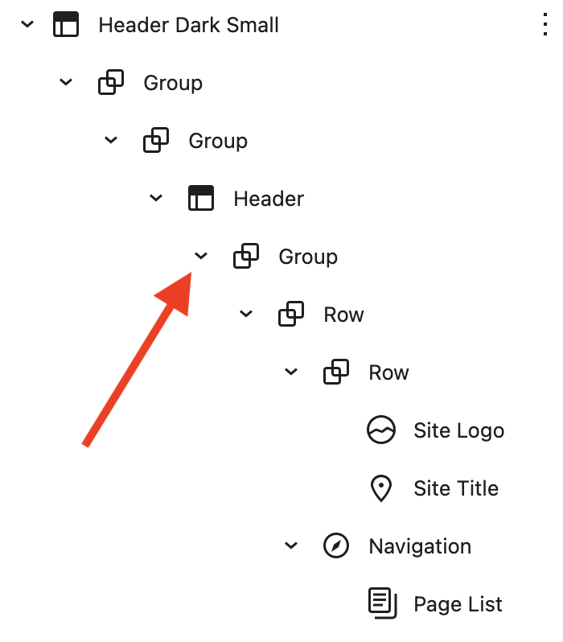
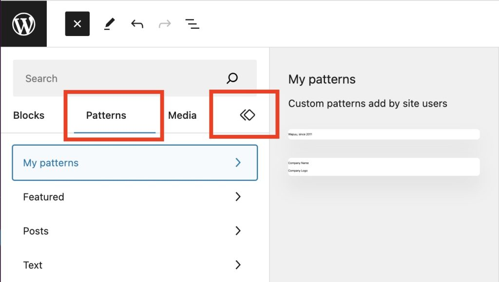
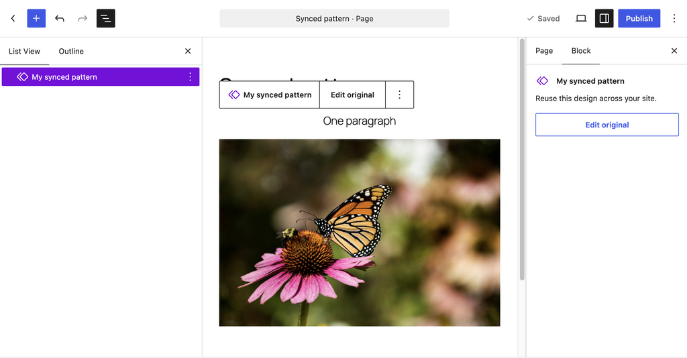
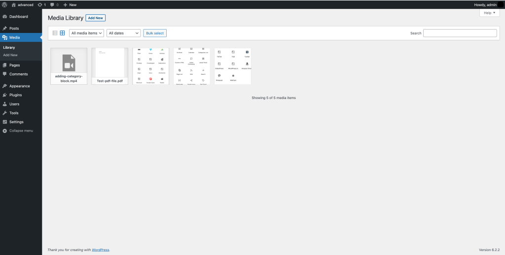
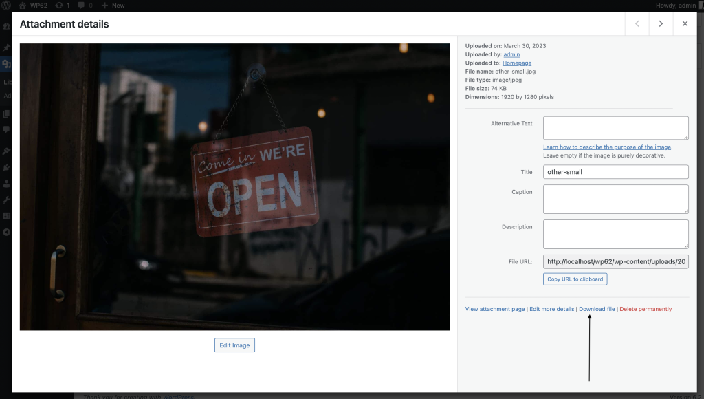
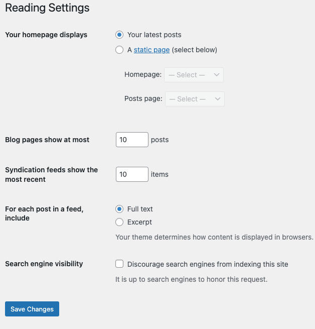
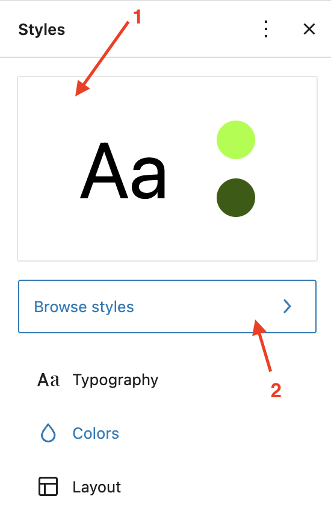

<!-- _class: cover -->

<span class="week">Week 2</span>

# Een bruikbare website ontwerpen

Van homepage naar een begrijpelijke bezoekersroute.

**Mijlpaal:** Home, navigatie, visuele richting en eigen CSS.

<figure class="visual">

<figcaption>Beeld: <a href="https://store.steampowered.com/app/413150/">Stardew Valley, ConcernedApe, via Steam</a></figcaption>
</figure>

<!-- Beeldbron: Stardew Valley, ConcernedApe, via Steam. https://shared.akamai.steamstatic.com/store_item_assets/steam/apps/413150/ss_b887651a93b0525739049eb4194f633de2df75be.1920x1080.jpg?t=1786554168. Geraadpleegd op 2026-10-30. Volledige brongegevens: ../assets/slides/BRONNEN.md -->


---

<!-- _class: lesson -->

# Wat je deze week leert

Je maakt van de lege installatie een website waarop een bezoeker begrijpt wat hij kan doen.

- Je bouwt Home en Over en stelt de startpagina in.
- Je onderscheidt unieke pagina-inhoud van gedeelde templates, header en footer.
- Je past één eigen CSS-regel gericht toe en legt het doel uit.
- Je controleert navigatie en leesbaarheid op verschillende schermen en met het toetsenbord.

De dynamische catalogus zelf volgt in week 3.

---

<!-- _class: visual lesson -->

# De route van een bezoeker

Een bezoeker van PixelAtlas komt op Home, kiest Games en opent daarna één game. Elke stap moet een duidelijke vervolgstap aanbieden.

Vandaag maak je de ingang met een herkenbare uitleg en navigatie. In week 3 verbind je die met het werkende catalogusarchief. Bekijk op het beeld waar de bezoeker de catalogus kan openen.

<figure class="visual">

<figcaption>Beeld: <a href="../Opdracht/docker/README.md">Eigen cursusvoorbeeld PixelAtlas. Gamebeelden: oorspronkelijke makers, via Steam</a></figcaption>
</figure>

<!-- Beeldbron: Eigen cursusvoorbeeld PixelAtlas. Gamebeelden: oorspronkelijke makers, via Steam. ../../Opdracht/docker/README.md. Geraadpleegd op 2026-10-30. Volledige brongegevens: ../assets/slides/BRONNEN.md -->


---

<!-- _class: lesson -->

# Eén bezoekersvraag als vertrekpunt

Stel je iemand voor die zegt: “Ik wil een geschikte game vinden.” Op Home moet die persoon begrijpen welke games de site bespreekt en hoe hij de verzameling bereikt.

Schrijf daarom eerst een korte introductie en kies een duidelijke vervolgstap, bijvoorbeeld **Bekijk alle games**.

Voor een receptenplatform wordt dat bijvoorbeeld **Zoek een avondmaaltijd**. De bezoekersvraag helpt je bepalen welke tekst, afbeelding en link op Home nodig zijn.

---

<!-- _class: lesson -->

# Welke inhoud wordt een pagina?

Gebruik een **pagina** voor informatie die een vaste plek in de site krijgt: Home, Over of contactinformatie.

Gebruik een **bericht** voor een publicatiestroom, bijvoorbeeld nieuws over een nieuwe game. Dat bericht kan een publicatiedatum en plaats in een berichtenlijst krijgen.

Een game zelf wordt in week 3 een catalogusitem. Houd die keuze nu al voor ogen, zodat je de volledige catalogus niet als losse vaste pagina's opbouwt.

---

<!-- _class: lesson -->

# De toekomstige URL `/games/`

Een **slug** is het herkenbare stuk van een URL, zoals `over` in `/over/`. Het gamearchief krijgt in ons lesvoorbeeld de slug `games`.

Maak deze week daarom geen gewone pagina met diezelfde slug. Die zou later met de archiefroute kunnen concurreren.

Wil je vooraf uitleg over de verzameling publiceren, kies dan een andere URL, bijvoorbeeld `/over-de-catalogus/`. In week 3 maak en test je de echte catalogusroute.

---

<!-- _class: lesson -->

# Tekst die de bezoeker verder helpt

Begin een pagina met een titel die haar onderwerp benoemt. Geef daarna een korte uitleg en gebruik tussenkoppen voor herkenbare delen van de inhoud.

**Voorbeeld voor Over:** “Hoe kiezen we games?” is concreter dan “Onze visie”. Leg vervolgens uit voor wie je schrijft en welke kenmerken je bespreekt.

Gebruik koppen voor structuur. Controleer de publieke pagina, want het thema kan de paginatitel zelf al als H1 weergeven.

---

<!-- _class: lesson -->

# Een link benoemt de bestemming

De tekst **Bekijk alle games** vertelt wat er na klikken volgt. **Klik hier** vertelt alleen welke handeling je kunt uitvoeren.

Dat verschil helpt ook iemand die met een schermlezer door links navigeert of de pagina snel scant.

Controleer elke link op de publieke site: klopt de bestemming en kun je de link met Tab bereiken en met Enter openen? Een duidelijk label en een werkende bestemming horen samen.

---

<!-- _class: lesson -->

# Een pagina opbouwen met blokken

In de blokeditor voeg je de unieke inhoud van één pagina toe. Een Kop-blok bevat een titel, een Alinea-blok uitleg en een Afbeelding-blok een beeld.

Een **Groep** kan die blokken samenhouden. Zo kun je één achtergrond of binnenruimte voor een volledige introductie instellen.

**Voorbeeld:** maak op Home een Groep met een kop, korte intro en een link naar een bestaande pagina. Controleer daarna de publieke weergave.

---

<!-- _class: visual lesson -->

# Ouder- en kindblokken herkennen

De Lijstweergave toont hoe blokken in elkaar zitten. Een Groep is de **ouder** van de kop en alinea die erin staan.

Selecteer de Groep om de hele sectie achtergrond of ruimte te geven. Selecteer de Kop om alleen de titeltekst te wijzigen.

Controleer vóór aanpassen welk blok geselecteerd is. Zo voorkom je dat een lokale wijziging onverwacht de hele sectie raakt.

<figure class="visual">

<figcaption>Beeld: <a href="https://wordpress.org/documentation/article/list-view/">WordPress.org</a></figcaption>
</figure>

<!-- Beeldbron: WordPress.org, documentatiebijdragers. https://wordpress.org/documentation/files/2021/12/Screen-Shot-2021-12-21-at-3.45.27-PM.png. Geraadpleegd op 2026-10-30. Volledige brongegevens: ../assets/slides/BRONNEN.md -->


---

<!-- _class: visual lesson -->

# Een patroon als vertrekpunt

Een patroon is een vooraf gemaakte combinatie van blokken, bijvoorbeeld een intro met titel, foto en knop. Je krijgt daarmee een structuur die je aan je eigen inhoud kunt aanpassen.

Vervang voorbeeldtekst, afbeeldingen en bestemmingen. Controleer vooral of de knop naar jouw site verwijst. Een patroon overnemen levert nog geen afgewerkte bezoekersroute op.

<figure class="visual">

<figcaption>Beeld: <a href="https://wordpress.org/documentation/article/block-pattern/">WordPress.org</a></figcaption>
</figure>

<!-- Beeldbron: WordPress.org, documentatiebijdragers. https://wordpress.org/documentation/files/2023/08/WP-6-3-create-patterns-1024x579.jpeg. Geraadpleegd op 2026-10-30. Volledige brongegevens: ../assets/slides/BRONNEN.md -->


---

<!-- _class: visual lesson -->

# Gedeelde en zelfstandige patronen

Een **gesynchroniseerd patroon** deelt inhoud en opbouw tussen de plaatsen waar je het gebruikt. Bewerk je het origineel, dan kan de wijziging overal verschijnen.

Bij een niet-gesynchroniseerde kopie pas je elke plaats afzonderlijk aan. Een algemene catalogusoproep kan gedeeld zijn; verschillende game-intro's hebben meestal eigen tekst nodig.

<figure class="visual">

<figcaption>Beeld: <a href="https://wordpress.org/documentation/article/list-view/">WordPress.org</a></figcaption>
</figure>

<!-- Beeldbron: WordPress.org, documentatiebijdragers. https://wordpress.org/documentation/files/2021/07/Screenshot-2026-09-09-at-3.26.35-PM-1024x534.png. Geraadpleegd op 2026-10-30. Volledige brongegevens: ../assets/slides/BRONNEN.md -->


---

<!-- _class: visual lesson -->

# Afbeeldingen kiezen en uploaden

Kies een beeld dat de inhoud helpt begrijpen, bijvoorbeeld een herkenbare gamecover op een detailpagina. Gebruik een bron met passend gebruiksrecht en noteer waar het beeld vandaan komt.

Upload een bestand met geschikte afmetingen en een duidelijke bestandsnaam. Geef betekenisvol beeld een alt-tekst die uitlegt wat het hier bijdraagt.

<figure class="visual">

<figcaption>Beeld: <a href="https://wordpress.org/documentation/article/media-library-screen/">WordPress.org</a></figcaption>
</figure>

<!-- Beeldbron: WordPress.org, documentatiebijdragers. https://wordpress.org/documentation/files/2023/06/media-library-grid-view-1-1024x518.png. Geraadpleegd op 2026-10-30. Volledige brongegevens: ../assets/slides/BRONNEN.md -->


---

<!-- _class: visual lesson -->

# Een mediabestand veilig verwijderen

De melding **Niet gekoppeld** betekent niet automatisch dat een afbeelding nergens verschijnt. Ze kan bijvoorbeeld gebruikt worden in een template, patroon of aangepast veld.

Controleer daarom eerst waar je het beeld gebruikt. Open de relevante publieke pagina's en zoek ook in gedeelde onderdelen. Een verwijderd bestand kan anders op meerdere pagina's een ontbrekende afbeelding veroorzaken.

<figure class="visual">

<figcaption>Beeld: <a href="https://wordpress.org/documentation/article/media-library-screen/">WordPress.org</a></figcaption>
</figure>

<!-- Beeldbron: WordPress.org, documentatiebijdragers. https://wordpress.org/documentation/files/2023/06/attachment-details-1-1024x580.png. Geraadpleegd op 2026-10-30. Volledige brongegevens: ../assets/slides/BRONNEN.md -->


---

<!-- _class: visual lesson -->

# Home als vaste startpagina instellen

Publiceer eerst de pagina Home. Open daarna **Instellingen → Lezen**, kies een statische homepage en wijs Home aan.

Sla op en open de basis-URL van je site in een privévenster. Daar moet nu de gekozen Home-pagina verschijnen.

Deze instelling kiest de inhoud voor de startpagina. Het thema en de gebruikte template bepalen hoe die inhoud eruitziet.

<figure class="visual">

<figcaption>Beeld: <a href="https://wordpress.org/documentation/article/settings-reading-screen/">WordPress.org</a></figcaption>
</figure>

<!-- Beeldbron: WordPress.org, documentatiebijdragers. https://wordpress.org/documentation/files/2021/06/options-reading.png. Geraadpleegd op 2026-10-30. Volledige brongegevens: ../assets/slides/BRONNEN.md -->


---

<!-- _class: lesson -->

# Wat doet een berichtenpagina?

Wil je nieuws publiceren, dan kun je een aparte pagina Blog maken en die onder **Instellingen → Lezen** als berichtenpagina aanwijzen.

WordPress gebruikt die bestemming voor de lijst met berichten. De tekst die je in de gewone pagina-editor van Blog schrijft, verschijnt daardoor doorgaans niet als intro boven die lijst.

Controleer dus de publieke pagina. Wil je de berichtenlijst anders opmaken, onderzoek dan de bijbehorende template of themafunctie.

---

<!-- _class: lesson -->

# Een klein menu met echte bestemmingen

Begin met Home en Over. Voeg Games pas toe zodra het archief in week 3 bestaat en je de juiste URL getest hebt.

Bij een blokthema beheer je navigatie via de Site-editor of het Navigatie-blok. Bij een klassiek thema kan **Weergave → Menu's** beschikbaar zijn.

Een nieuwe pagina verschijnt niet noodzakelijk vanzelf in het bedoelde menu. Controleer na opslaan de publieke header en het mobiele menu.

---

<!-- _class: lesson -->

# Tijdelijke menulinks geven verwarring

Een menu-item met `#` of `##` als bestemming lijkt bruikbaar, maar brengt de bezoeker niet naar de beloofde catalogus of pagina.

Gebruik alleen werkende bestemmingen. Laat een toekomstige route weg tot ze bestaat, of verwijs met duidelijke tekst naar een bestaande uitlegpagina.

Doorloop het menu met Tab en Enter. Controleer dat elke link een zinvolle bestemming opent en dat de gebruiker daarna verder kan navigeren.

---

<!-- _class: lesson -->

# Header en footer zijn gedeeld

De **header** bevat bijvoorbeeld de sitetitel en navigatie. De **footer** sluit pagina's af met relevante contact- of broninformatie.

Deze onderdelen worden vaak door meerdere templates gebruikt. Een aanpassing aan de gedeelde header kan dus tegelijk Home, Over en je latere catalogus veranderen.

Controleer vóór opslaan welk onderdeel je bewerkt. Bekijk na een wijziging minstens twee verschillende publieke pagina's om het bereik te begrijpen.

---

<!-- _class: lesson -->

# Blokthema en klassiek thema

Een **blokthema** biedt doorgaans **Weergave → Editor** voor templates, onderdelen en globale stijlen.

Een **klassiek thema** gebruikt PHP-templates en kan instellingen aanbieden via de Customizer, menu's of eigen schermen. PixelAtlas is zo'n klassiek thema; de Site-editorbeelden tonen de route voor een blokthema.

Controleer welk thema jij gebruikt voordat je een instelling zoekt. Dezelfde ontwerpkeuze kan in een ander thema op een andere plaats staan.

---

<!-- _class: lesson -->

# Pagina-inhoud en template onderscheiden

De pagina **Over** bevat haar eigen tekst. De **Page-template** bepaalt de gedeelde structuur waarin die tekst verschijnt, bijvoorbeeld titel, inhoudsgebied en footer.

Bij een blokthema haalt het blok **Content/Berichtinhoud** de tekst van de huidige pagina op. Daardoor kan één template zowel Home als Over tonen met telkens andere inhoud.

Bewerk de pagina voor een tekstwijziging. Bewerk de template wanneer je bewust de gedeelde paginaopbouw wilt veranderen.

---

<!-- _class: lesson -->

# Waarom staat Over plots overal?

Je plakt “Over onze gamegids” rechtstreeks in de gedeelde Page-template. Daarna zie je dezelfde tekst ook op een andere pagina.

Dat gebeurt omdat de template voor meerdere pagina's geldt. Verplaats de unieke tekst naar de pagina Over en laat de template de huidige pagina-inhoud ophalen via **Content/Berichtinhoud**.

Open vervolgens twee verschillende pagina's. De structuur mag gedeeld zijn, maar elke pagina moet haar eigen tekst tonen.

---

<!-- _class: visual lesson -->

# Eén visuele richting voor de site

Kies een beperkt kleurenpalet, leesbare lettertypes en herkenbare links. Pas die keuzes bij een blokthema via de globale stijlen toe.

Het Stijlboek toont voorbeelden van blokken, zodat je combinaties kunt beoordelen. Controleer daarna ook je eigen pagina's met echte inhoud op mobiel: lange titels en eigen beelden kunnen daar anders uitvallen.

<figure class="visual">

<figcaption>Beeld: <a href="https://wordpress.org/documentation/article/styles-overview/">WordPress.org</a></figcaption>
</figure>

<!-- Beeldbron: WordPress.org, documentatiebijdragers. https://wordpress.org/documentation/files/2022/10/Screen-Shot-2022-10-13-at-12.04.54-PM.png. Geraadpleegd op 2026-10-30. Volledige brongegevens: ../assets/slides/BRONNEN.md -->


---

<!-- _class: lesson -->

# Een eigen CSS-regel met een doel

De opdracht vraagt minstens één zichtbaar werkende eigen CSS-aanpassing. Kies eerst welk probleem je wilt oplossen.

**Voorbeeld:** de intro van je catalogus valt onvoldoende op. Je geeft de omvattende Groep een eigen klasse en voegt een gekleurde rand met binnenruimte toe.

Bewaar de CSS op de passende plaats voor je thema. Noteer in je README het doel, de locatie van de code en wat je vóór en na controleerde.

---

<!-- _class: lesson -->

# Een regel gericht op één sectie

Geef het Groep-blok onder **Geavanceerd → Extra CSS-klasse(n)** de klasse `project-intro`, zonder punt. De CSS-selector krijgt wel een punt:

```css
.project-intro {
  border-inline-start: .3rem solid #176b64;
  padding-inline-start: 1rem;
}
```

De rand markeert de intro; de padding houdt tekst van de rand weg. Alleen elementen met deze klasse krijgen dit effect. Controleer het resultaat op de publieke pagina.

---

<!-- _class: lesson -->

# Dezelfde inhoud op drie schermen

Bekijk Home, Over, header en footer op smartphone, tablet en desktop. Controleer of lange titels leesbaar blijven en kolommen onder elkaar kunnen komen.

Let op bediening: kun je het mobiele menu openen, elke link kiezen en terugkeren? Moet je onbedoeld horizontaal scrollen?

Een brede editorweergave voorspelt dat gedrag niet volledig. Gebruik echte pagina's met je eigen teksten en beelden en noteer minstens één concrete verbetering.

---

<!-- _class: lesson -->

# Navigeren zonder muis

Begin bovenaan de publieke pagina en druk herhaaldelijk op **Tab**. De focus moet zichtbaar langs links, knoppen en menu-items gaan.

Gebruik **Shift+Tab** om terug te gaan en **Enter** om een link te openen. Controleer ook of het mobiele menu met toetsenbord bruikbaar is.

Als je niet ziet welk onderdeel actief is, kan een bezoeker de route moeilijk volgen. Zoek dan de oorzaak in de focusstijl of het gebruikte menu.

---

<!-- _class: lesson -->

# Projectwerk: een bruikbare eerste versie

Schrijf je bezoekersvraag op en bouw Home en Over met echte inhoud. Publiceer Home en stel haar als startpagina in.

Maak een klein menu met werkende bestemmingen. Kies een doelgericht beeld, controleer gedeelde onderdelen en voeg je eigen CSS-aanpassing toe.

Test daarna de publieke site op drie schermgroottes en met het toetsenbord. Bewaar korte notities van de gebruikte URL's, de gevonden problemen en de aangebrachte verbetering.

---

<!-- _class: question lesson -->

# Kennischeck: de verkeerde bewerkplek

Je verandert de introductietekst van Over. Daarna staat die tekst ook op Home. Tegelijk wil je het logo op alle pagina's vervangen.

1. Waar hoort de unieke tekst van Over te staan?
2. Welk gedeeld onderdeel pas je aan voor het logo?
3. Hoe controleer je na opslaan of alleen de bedoelde inhoud veranderde?

<!-- Bespreek: pagina-editor voor Over; gedeelde header voor het logo; minstens Home en Over publiek openen en op mobiel controleren. -->

---


<!-- _class: milestone -->

# Weekmijlpaal

**Bruikbare eerste versie met homepage, navigatie, visuele richting en zichtbare eigen CSS.**

Bron: [projectopdracht](../Opdracht/docker/projectopdracht.md)

<!-- Afbeeldingsbronnen bij deze week: ../assets/slides/BRONNEN.md -->
