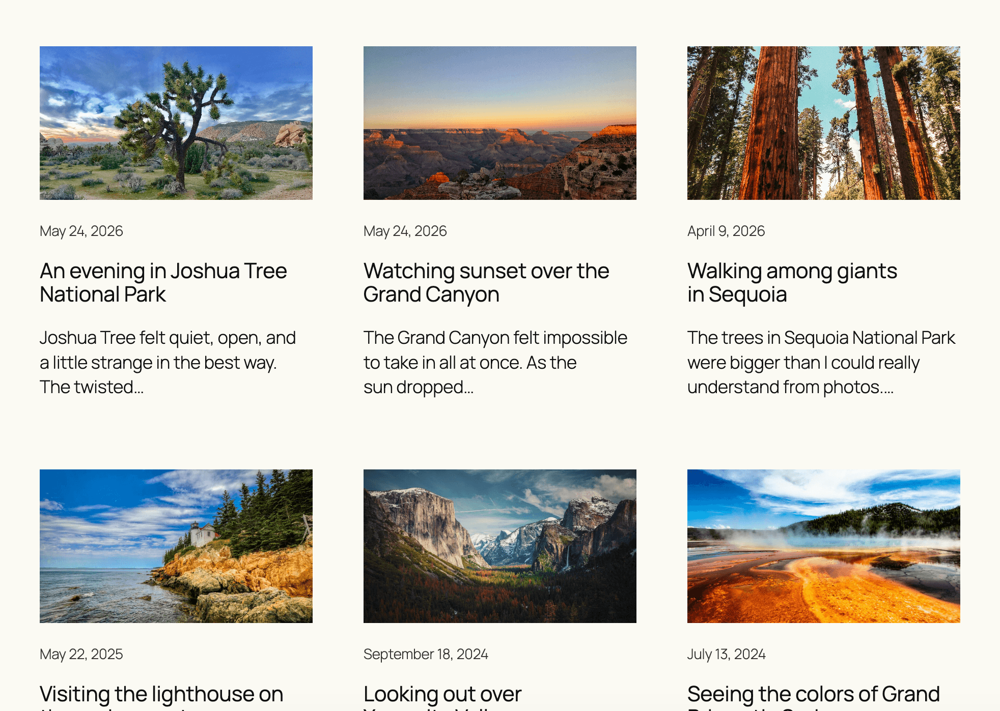
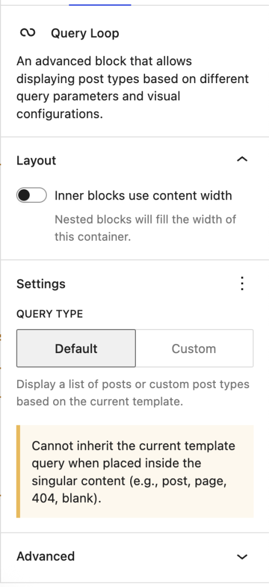
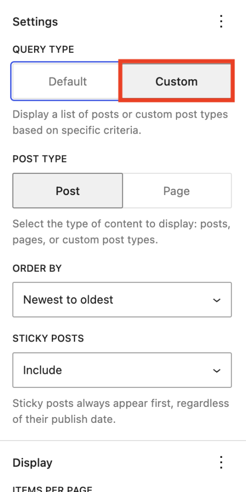

<!-- _class: cover -->

<span class="week">Week 3</span>

# Van inhoudsmodel naar dynamische catalogus

Van bezoekersvraag naar tien echte items.

**Mijlpaal:** CPT, velden, termen, archief en detailpagina's.

<figure class="visual">

<figcaption>Beeld: <a href="https://store.steampowered.com/app/1145360/">Hades, Supergiant Games, via Steam</a></figcaption>
</figure>

<!-- Beeldbron: Hades, Supergiant Games, via Steam. https://shared.akamai.steamstatic.com/store_item_assets/steam/apps/1145360/library_600x900.jpg. Geraadpleegd op 2026-10-30. Volledige brongegevens: ../assets/slides/BRONNEN.md -->


---


<!-- _class: lesson -->

# Wat je deze week leert

Je geeft de catalogus een vaste structuur, zodat je gegevens per item kunt bewaren en bezoekers ze kunnen vergelijken.

- Je onderscheidt een contenttype, item, taxonomie, term en veld.
- Je activeert een registratie buiten het thema en maakt één volledig item.
- Je controleert of ingevulde gegevens ook op de publieke detailpagina verschijnen.
- Je bouwt de route via het archief naar minstens tien uitgewerkte items.


---


<!-- _class: visual lesson -->

# De bezoekersvraag bepaalt de gegevens

“Welke puzzelgames zijn geschikt voor twee spelers?” vraagt gegevens die je consequent kunt terugvinden: een genre en een duidelijk omschreven spelersaantal.

Alleen losse beschrijvingen doorzoeken maakt vergelijken lastig. Met vaste termen en velden kun je dezelfde kenmerken per game invullen. De vergelijking in PixelAtlas toont waarom zo'n gedeelde structuur nuttig is.

<figure class="visual">

<figcaption>Beeld: <a href="../Opdracht/docker/README.md">Eigen cursusvoorbeeld PixelAtlas. Gamebeelden: oorspronkelijke makers, via Steam</a></figcaption>
</figure>

<!-- Beeldbron: Eigen cursusvoorbeeld PixelAtlas. Gamebeelden: oorspronkelijke makers, via Steam. ../../Opdracht/docker/README.md. Geraadpleegd op 2026-10-30. Volledige brongegevens: ../assets/slides/BRONNEN.md -->


---


<!-- _class: lesson -->

# Een contenttype bevat afzonderlijke items

Een **custom post type**, afgekort CPT, is een eigen inhoudssoort in WordPress. In ons voorbeeld heet die soort Game.

Een concrete game is één **item binnen dat type**, met een eigen titel, inhoud, publicatiestatus en URL. Je maakt dus niet voor elke game een nieuw contenttype.

**Ander onderwerp:** Recept is het contenttype; “Pompoensoep” is één receptitem. Die vaste soort maakt een gezamenlijke lijst en gedeelde detailopmaak mogelijk.


---


<!-- _class: lesson -->

# Taxonomie en term: groep en keuze

Een **taxonomie** bepaalt volgens welk kenmerk je items groepeert. **Genre** is de taxonomie; **Puzzel** en **Strategie** zijn termen die je daarin kiest.

Je kunt meerdere games aan dezelfde term koppelen. Zo kan WordPress een gezamenlijke lijst met puzzelgames tonen.

Bij een receptenplatform kan de taxonomie Maaltijd heten, met Ontbijt en Avondeten als termen. Maak groepen die helpen bij een echte bezoekersvraag.


---


<!-- _class: lesson -->

# Een veld heeft één vaste betekenis

Een **veld** bewaart een specifieke waarde bij één item. Denk aan een studionaam als tekst of een spelersaantal als getal.

Leg precies vast wat het getal betekent: bijvoorbeeld het maximumaantal gelijktijdige spelers. Gebruik die betekenis bij elk item, zodat vergelijken eerlijk blijft.

Voor recepten geldt hetzelfde: bewaar bereidingstijd bijvoorbeeld steeds in minuten. De waarden `35` en `120` kun je dan vergelijken zonder eerst verschillende eenheden te vertalen.


---


<!-- _class: lesson -->

# Welke uitleg blijft vrije tekst?

De inhoudseditor is geschikt voor uitleg die per item mag verschillen: hoe speelt de game, voor wie is ze geschikt en wat valt op?

Een vast veld helpt wanneer een gegeven dezelfde betekenis heeft en je het wilt vergelijken of selecteren. Een langere persoonlijke toelichting past beter in de beschrijving.

**Voorbeeld:** Genre is Puzzel, het spelersveld bevat 2 en de beschrijving legt uit waarom samenwerken bij deze fictieve game leuk is.


---


<!-- _class: lesson -->

# Wat de projectopdracht minimaal vraagt

Je catalogus bevat minstens één eigen contenttype met relevante gestructureerde velden, minstens twee betekenisvolle categorieën of taxonomietermen en minstens tien uitgewerkte items.

Die gegevens moeten zichtbaar bijdragen aan de site. Je toont dus een werkend archief, bruikbare detailpagina's en een route vanaf Home.

Begin met één volledig voorbeelditem. Controleer invoer en publieke uitvoer vóór je de overige items uitwerkt; anders kopieer je mogelijk dezelfde fout tien keer.


---


<!-- _class: lesson -->

# Hoeveel groepen en velden heb je nodig?

De opdracht legt geen verplicht minimum van twee aparte taxonomieën op. Eén passende taxonomie met twee betekenisvolle termen kan volstaan.

Kies extra velden of groepen wanneer je bezoekersvraag die nodig maakt. Voor “Welke puzzelgame past bij mij?” kan Genre voldoende groepering geven. Een vraag naar platformen kan een extra indeling rechtvaardigen.

Leg telkens uit wat de bezoeker met het gegeven kan doen. Meer invoervakken maken een model niet automatisch bruikbaarder.


---


<!-- _class: compact lesson -->

# De datadictionary maakt keuzes expliciet

Een **datadictionary** is een korte afspraak over elk gegeven: wat het betekent, welk type het heeft en waar het verschijnt.

| Gegeven | Type en voorbeeld | Gebruik |
| --- | --- | --- |
| Genre | Term: Puzzel | Groeperen en termarchief |
| Studio | Tekst: Studio Noord | Detailpagina |
| Maximumaantal spelers | Geheel getal: 2 | Kenmerk op detailpagina |

De studionaam is fictief. Gebruik voor je eigen onderwerp consequente waarden en beschrijf eventuele eenheden.


---


<!-- _class: lesson -->

# Het inhoudsmodel in een plug-in

Registreer het CPT in een plug-in. Het thema verzorgt de presentatie; de registratie bepaalt dat WordPress je inhoudssoort kent.

Bij een themawissel blijft de plug-in actief en kan het type beschikbaar blijven. Je moet mogelijk de weergave in het nieuwe thema aanpassen.

Staat de registratie alleen in het oude thema, dan kan het beheermenu voor Games verdwijnen zodra je wisselt. De opgeslagen items zijn daarmee niet noodzakelijk uit de database gewist.


---


<!-- _class: lesson -->

# Technische sleutel en zichtbaar label

De sleutel `cursus_game` identificeert het contenttype in code en bij opgeslagen items. Het label **Games** is de naam die de gebruiker in het beheermenu leest.

Je kunt een vriendelijk label kiezen zonder de technische sleutel telkens te veranderen. Gebruik een stabiele, herkenbare sleutel voor je eigen project.

Verander je die sleutel later, dan koppelt WordPress bestaande items niet vanzelf aan de nieuwe naam. Plan zo'n wijziging bewust.


---


<!-- _class: lesson -->

# Wat doen de CPT-instellingen?

Deze instellingen in de registratie hebben elk een concreet effect:

- `public`: maakt het type geschikt voor publieke weergave met de bijbehorende standaardinstellingen.
- `show_in_rest`: stelt het type beschikbaar via de REST API, nodig voor de blokeditor naast editorondersteuning.
- `has_archive`: schakelt een gezamenlijke archiefroute in.
- `supports`: kiest functies zoals titel, editor, afbeelding en reacties.

Een registratie maakt nog geen afgewerkt ontwerp of bezoekersfilter. Dat controleer je in de volgende stappen.


---


<!-- _class: lesson -->

# Eén manier om hetzelfde type te registreren

Je mag een eigen plug-in schrijven of een onderhouden registratieoplossing gebruiken. Kies één aanpak voor hetzelfde contenttype.

Als twee plug-ins allebei `cursus_game` proberen te registreren, kunnen instellingen of labels elkaar beïnvloeden. Dan is onduidelijk welke registratie het gedrag bepaalt.

Bekijk vóór activeren of je al een eigen CPT hebt. Gebruik het lesvoorbeeld als vergelijking of oefening, en voeg geen tweede registratie toe aan een type dat al werkt.


---


<!-- _class: lesson -->

# Wat zit in het lesvoorbeeld?

Het bestand [voorbeeldcatalogus.php](voorbeeldcatalogus.php) registreert Games en Genre. Het voegt invoervelden voor Studio en Aantal spelers toe en levert de shortcode `[cursus_gamegegevens]` om die waarden te tonen.

Dit kleine voorbeeld maakt het pad van invoer naar publieke uitvoer zichtbaar. De uitgebreide PixelAtlas-demo gebruikt eigen sleutels en code. Meng beide oplossingen niet ongemerkt in hetzelfde model.

Pas naamgeving en velden aan wanneer je eigen onderwerp dat vraagt.


---


<!-- _class: lesson -->

# De voorbeeldplug-in beschikbaar maken

Bewaar de voorbeeldcode als `plugins/cursus-catalogus/cursus-catalogus.php` in je project. Voeg de bind mount uit [de theorie](Ch3-theorie.md#voer-het-lesvoorbeeld-uit) toe onder `wordpress.volumes`.

Voer daarna vanuit je projectmap uit:

```bash
docker compose config --quiet
docker compose up -d
```

Activeer **Cursuscatalogus (voorbeeld)** onder Plug-ins. Het menu Games hoort te verschijnen. Bewaar de code in Git voor herstel.


---


<!-- _class: lesson -->

# Een werkende archief-URL krijgen

Na registratie moet WordPress weten welke URL bij het nieuwe archief hoort. Open **Instellingen → Permalinks** en sla de instellingen één keer op.

Gebruikt de lege site nog de eenvoudige structuur, kies dan zoals in de theorie een leesbare structuur. Test bestaande links na een wijziging.

Open daarna `/games/`. Controleer bij een 404 de actieve plug-in, archiefinstelling en slug. Maak geen gewone pagina met dezelfde slug om het probleem te verbergen.


---


<!-- _class: lesson -->

# Termen aanmaken en items indelen

Maak onder **Games → Genres** bijvoorbeeld Puzzel en Strategie aan. Open daarna een game en kies de term die bij dat item past.

Een term bestaat los van de toewijzing: alleen Puzzel aanmaken plaatst nog geen game in die groep.

Gebruik later twee duidelijk verschillende testitems: één dat onder Puzzel hoort en één dat uitsluitend onder Strategie valt. Daarmee kun je zowel de treffer als de uitsluiting controleren.


---


<!-- _class: visual lesson -->

# Eén item volledig uitwerken

Maak eerst één game met een eigen titel, beschrijving, passende term en ingevulde velden. Voeg een bruikbaar beeld toe en publiceer het item.

Open daarna de publieke detailpagina. Vind je daar dezelfde inhoud en waarden terug? Het beeld toont de uitgebreidere PixelAtlas-demo; jouw eerste oefenitem mag eenvoudiger zijn, zolang invoer en uitvoer controleerbaar werken.

<figure class="visual">

<figcaption>Beeld: <a href="../Opdracht/docker/README.md">Eigen cursusvoorbeeld PixelAtlas. Gamebeelden: oorspronkelijke makers, via Steam</a></figcaption>
</figure>

<!-- Beeldbron: Eigen cursusvoorbeeld PixelAtlas. Gamebeelden: oorspronkelijke makers, via Steam. ../../Opdracht/docker/README.md. Geraadpleegd op 2026-10-30. Volledige brongegevens: ../assets/slides/BRONNEN.md -->


---


<!-- _class: lesson -->

# Een ingevuld veld zichtbaar maken

Een waarde in het beheerscherm is alleen opgeslagen invoer. De bezoeker ziet haar pas wanneer een shortcode, blok of template de waarde ophaalt en weergeeft.

Controleer het hele pad: vul Studio in, sla op, heropen het item en bezoek de publieke detailpagina. Komt dezelfde studionaam daar terug?

Ontbreekt de uitvoer, onderzoek dan de weergave in de volgende slide. Maak niet meteen een tweede veld met dezelfde betekenis aan.


---


<!-- _class: lesson -->

# De shortcode in het voorbeeld gebruiken

Voeg in de inhoud van het game-item een **Shortcode**-blok toe met:

```text
[cursus_gamegegevens]
```

Werk het item bij en open de publieke detailpagina. De shortcode haalt Studio en Aantal spelers van dat item op en toont ingevulde waarden.

Bij een blokthema moet de Single-template ook **Content/Berichtinhoud** tonen, anders ontbreekt de inhoud met de shortcode. Een leeg optioneel veld hoort geen leeg label op te leveren.


---


<!-- _class: lesson -->

# Home, archief en detail hebben elk een taak

**Home** introduceert de site en wijst de weg naar de inhoud. Het **archief** op `/games/` toont meerdere gepubliceerde games. Een **detailpagina** toont één gekozen game met haar eigen tekst en kenmerken.

Test de volledige route door te klikken: Home, Games, één titel en terug naar de lijst. Een lijst met titels is pas bruikbaar wanneer de bezoeker de bijbehorende detailpagina kan openen.

Voeg de werkende archief-URL nu aan de navigatie toe.


---


<!-- _class: lesson -->

# Het termarchief controleren

De route `/genre/puzzel/` hoort de gepubliceerde games te tonen waaraan je de term Puzzel hebt toegewezen.

Kies vooraf twee testitems. Je puzzelgame moet verschijnen; een game die **uitsluitend Strategie** heeft, hoort te ontbreken. Een game met beide termen kan terecht in beide archieven staan.

Deze controle gaat dus over de werkelijke toewijzing. Klik ook door naar een detailpagina en controleer een terugweg naar Alle games.


---


<!-- _class: visual lesson -->

# Wat doet een Query Loop?

Een **Query Loop** vraagt items op en herhaalt voor elk resultaat dezelfde blokopbouw. Die herhaling heet de Post Template.

Kies bijvoorbeeld titel, afbeelding en een korte tekst. WordPress vult die blokken telkens met de gegevens van het volgende item.

Controleer links naar details en voeg waar nodig paginering en een melding voor geen resultaten toe.

<figure class="visual">

<figcaption>Beeld: <a href="https://wordpress.org/documentation/article/query-loop-block/">WordPress.org</a></figcaption>
</figure>

<!-- Beeldbron: WordPress.org, documentatiebijdragers. https://wordpress.org/documentation/files/2021/07/query-loop-grid-featured-image.png. Geraadpleegd op 2026-10-30. Volledige brongegevens: ../assets/slides/BRONNEN.md -->


---


<!-- _class: visual lesson -->

# De query afstemmen op de pagina

Op een termarchief moet de lijst de huidige term blijven volgen. Gebruik daar de **templatequery**, zodat Puzzel ook werkelijk de selectie bepaalt.

Voor een losse Home-sectie “Nieuwste games” kun je bewust een **Custom** selectie instellen.

Een verkeerde vaste selectie in een archieftemplate kan alle genres dezelfde lijst laten tonen. Test daarom twee termroutes met verschillende verwachte resultaten.

<figure class="visual">

<figcaption>Beeld: <a href="https://wordpress.org/documentation/article/query-loop-block/">WordPress.org</a></figcaption>
</figure>

<!-- Beeldbron: WordPress.org, documentatiebijdragers. https://wordpress.org/documentation/files/2021/07/query-loop-block-settings-default-selected-471x1024.png. Geraadpleegd op 2026-10-30. Volledige brongegevens: ../assets/slides/BRONNEN.md -->


---


<!-- _class: visual lesson -->

# Redactionele lijst of bezoekerskeuze?

Je stelt als maker een Query Loop vast in op Puzzel. Die pagina toont dan steeds jouw gekozen selectie.

Een **bezoekersfilter** geeft de bezoeker zelf een keuze, bijvoorbeeld links naar Puzzel, Strategie en Alle games.

De vaste lijst kan nuttig zijn als uitgelichte sectie. Voor de filtertaak van week 4 moet de bezoeker de selectie zelf kunnen veranderen.

<figure class="visual">

<figcaption>Beeld: <a href="https://wordpress.org/documentation/article/query-loop-block/">WordPress.org</a></figcaption>
</figure>

<!-- Beeldbron: WordPress.org, documentatiebijdragers. https://wordpress.org/documentation/files/2026/05/query-loop-custom-query-type-selected-outlined-513x1024.png. Geraadpleegd op 2026-10-30. Volledige brongegevens: ../assets/slides/BRONNEN.md -->


---


<!-- _class: lesson -->

# Tien items die je model aantonen

Werk minstens tien catalogusitems inhoudelijk uit. Geef elk item een eigen beschrijving en passende waarden, termen en beelden.

Varieer bewust: verschillende genres en spelersaantallen helpen later bij de zoek- en filtertests. Controleer ook een item met een leeg optioneel veld.

Tien kopieën met bijna dezelfde tekst laten niet zien of het model bruikbaar is. Controleer eerst één volledig item en werk daarna de rest met dezelfde afspraken uit.


---


<!-- _class: lesson -->

# Controleren zoals een bezoeker

Open de publieke site zonder ingelogde beheerder. Doorloop Home, catalogus, een termarchief en twee verschillende detailpagina's.

Vergelijk titel, beschrijving en veldwaarden met het beheer. Controleer of de afbeeldingen laden en de links op telefoon én desktop bereikbaar zijn.

Laat één optioneel veld bewust leeg en controleer of de pagina begrijpelijk blijft. Noteer de gebruikte items en URL's, zodat je na wijzigingen dezelfde test kunt herhalen.


---


<!-- _class: question lesson -->

# Kennischeck: het model van één game

Je fictieve game Maanpuzzel hoort bij Genre Puzzel. Studio Noord maakte de game en het vastgelegde maximum is twee gelijktijdige spelers.

1. Wat zijn in dit voorbeeld het contenttype, item, de taxonomie en de term?
2. Welke gegevens bewaar je als velden en waarom?
3. Wat moet na invullen nog gebeuren voordat de bezoeker die velden ziet?

<!-- Bespreek: Game, Maanpuzzel, Genre, Puzzel; Studio en maximumspelers als vaste waarden; opslaan en tonen via shortcode of template, gevolgd door publieke controle. -->


---


<!-- _class: milestone -->

# Weekmijlpaal

**Dynamische catalogus met detailpagina's en tien uitgewerkte items.**

Bron: [projectopdracht](../Opdracht/docker/projectopdracht.md)

<!-- Afbeeldingsbronnen bij deze week: ../assets/slides/BRONNEN.md -->
