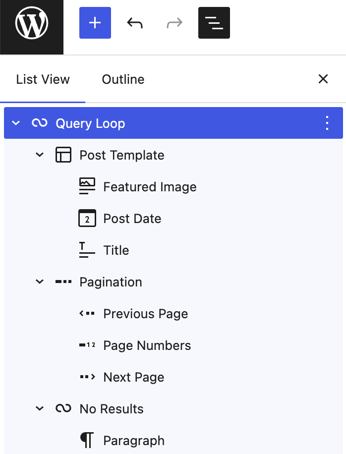
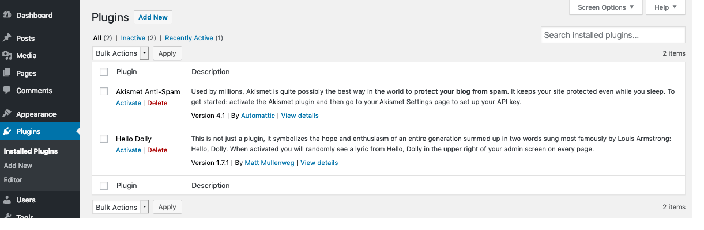
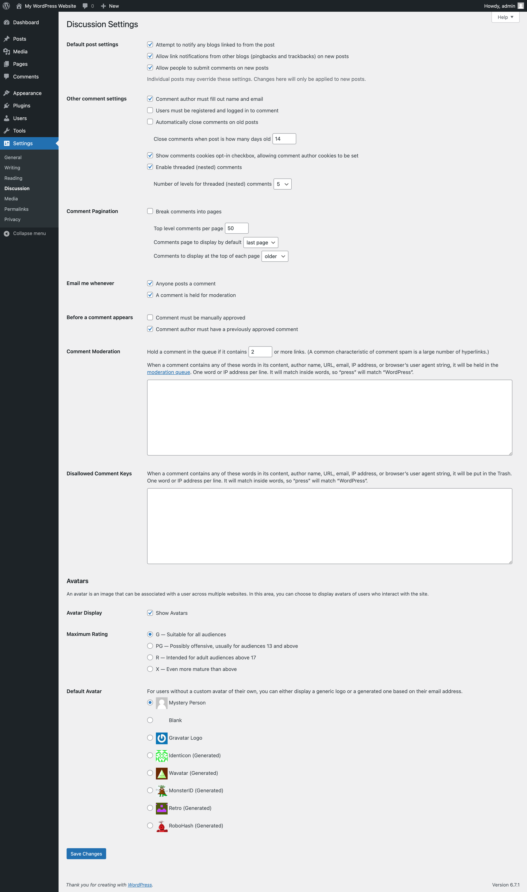
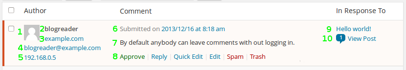
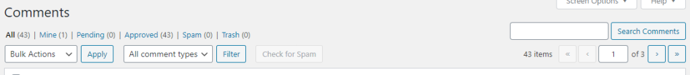
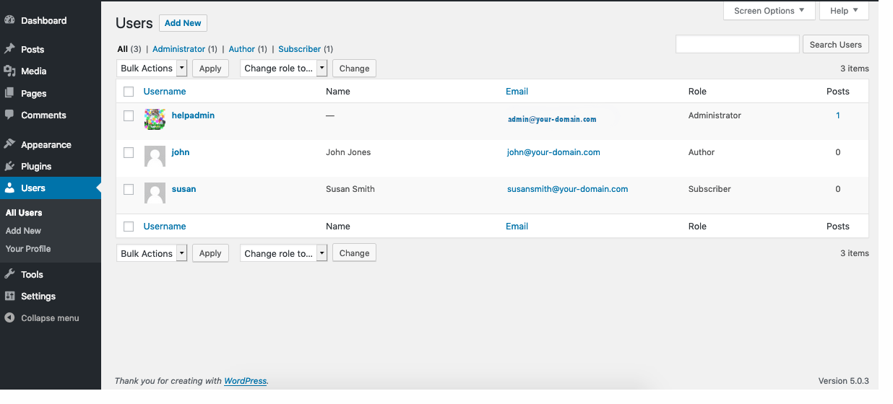

<!-- _class: cover -->

Week 4

# Bezoekers vinden inhoud en kunnen reageren

Zoeken of filteren, interactie en rollen.

**Mijlpaal:** werkende taak en aantoonbaar rolverschil.

<figure class="visual">

<figcaption>Beeld: <a href="https://store.steampowered.com/app/391540/">Undertale, tobyfox, via Steam</a></figcaption>
</figure>

<!-- Beeldbron: Undertale, tobyfox, via Steam. https://shared.akamai.steamstatic.com/store_item_assets/steam/apps/391540/library_600x900.jpg. Geraadpleegd op 2026-10-30. Volledige brongegevens: ../assets/slides/BRONNEN.md -->

---

<!-- _class: lesson -->

# Wat je deze week leert

Je controleert of bezoekers de juiste inhoud vinden, een reactie kunnen indienen en of beheerders alleen hun toegestane taken kunnen uitvoeren.

- Je beschrijft een zoek- of filtertaak met verwachte treffers en uitsluitingen.
- Je test indiening, moderatie en publieke weergave van een fictieve reactie.
- Je vergelijkt minstens twee rollen met concrete toegestane en geweigerde handelingen.

Een specifieke filter-, review- of rollenplug-in is geen automatische verplichting.

---

<!-- _class: lesson -->

# Een bezoekersvraag wordt een test

Neem als taak: “Vind een puzzelgame en lees voor hoeveel spelers ze bedoeld is.” Schrijf vóór het bouwen op welke items in de selectie horen.

Gebruik bijvoorbeeld Maanpuzzel met de term Puzzel en Rijkbouwers met uitsluitend Strategie als fictieve testitems.

Maanpuzzel moet na de keuze Puzzel verschijnen; Rijkbouwers moet ontbreken. Daarna moet de bezoeker de detailpagina kunnen openen. Daarmee maak je het verwachte gedrag controleerbaar.

---

<!-- _class: lesson -->

# Een zoekvak daadwerkelijk gebruiken

Een zoekformulier kan mooi op de pagina staan terwijl het verkeerde inhoudstype doorzocht wordt. Controleer daarom de uitkomst.

Zoek eerst naar de exacte titel van een gepubliceerd catalogusitem, daarna naar een algemener woord en ten slotte naar iets dat nergens voorkomt.

Noteer welke items je verwachtte en wat verscheen. Een werkende zoektaak omvat de resultaten, de doorklik naar een detailpagina en een begrijpelijke uitkomst wanneer niets gevonden wordt.

---

<!-- _class: visual lesson -->

# Filteren met termlinks

Een eenvoudige route gebruikt **Alle games**, **Puzzel** en **Strategie** als links naar het archief en de echte termarchieven.

De bezoeker kiest zo zelf een groep en kan terug naar de volledige catalogus. Kopieer de publieke term-URL's uit je eigen site. PixelAtlas toont op het beeld een uitgebreidere filterbalk; die extra vormgeving is niet verplicht.

<figure class="visual">

<figcaption>Beeld: <a href="../Opdracht/docker/README.md">Eigen cursusvoorbeeld PixelAtlas. Gamebeelden: oorspronkelijke makers, via Steam</a></figcaption>
</figure>

<!-- Beeldbron: Eigen cursusvoorbeeld PixelAtlas. Gamebeelden: oorspronkelijke makers, via Steam. ../../Opdracht/docker/README.md. Geraadpleegd op 2026-10-30. Volledige brongegevens: ../assets/slides/BRONNEN.md -->

---

<!-- _class: visual lesson -->

# De lijst moet de gekozen term volgen

Op het termarchief Puzzel hoort de lijst de games met die term te selecteren. De templatequery bewaart die context.

Een eigen vaste query kan die selectie overschrijven en bijvoorbeeld alle games tonen. Controleer daarom de Query Loop én het resultaat.

Open twee termarchieven met verschillende items. Krijg je onterecht dezelfde lijst, onderzoek dan welke query de template gebruikt.

<figure class="visual">

<figcaption>Beeld: <a href="https://wordpress.org/documentation/article/query-loop-block/">WordPress.org</a></figcaption>
</figure>

<!-- Beeldbron: WordPress.org, documentatiebijdragers. https://wordpress.org/documentation/files/2021/07/query-loop-list-view.png. Geraadpleegd op 2026-10-30. Volledige brongegevens: ../assets/slides/BRONNEN.md -->

---

<!-- _class: lesson -->

# Een vaste selectie of een bedienbaar filter

Een pagina waarop jij een Query Loop op Puzzel hebt ingesteld, toont steeds dezelfde vooraf gekozen groep. Dat kan een nuttige redactionele lijst zijn.

Bij een filtertaak kan de **bezoeker** een keuze wijzigen. Met termlinks kan hij bijvoorbeeld van Puzzel naar Strategie gaan en terug naar Alle games.

Controleer dus wie de selectie bepaalt en hoe de bezoeker verdergaat. Alleen een filterinstelling in het beheerscherm bewijst die bediening niet.

---

<!-- _class: lesson -->

# Waarom ook een uitsluiting testen?

Een te brede query kan je verwachte puzzelgame tonen én onterecht alle andere games. Als je alleen de treffer controleert, lijkt die fout toch een succes.

Test daarom ook Rijkbouwers, dat in ons fictieve voorbeeld uitsluitend Strategie heeft. Onder Puzzel hoort dat item te ontbreken.

Heeft een item bewust beide termen, dan mag het in beide groepen verschijnen. Vergelijk steeds met de werkelijke termtoewijzingen die je vooraf noteerde.

---

<!-- _class: lesson -->

# Geen resultaten is ook een uitkomst

Zoek naar een woord dat niet in je catalogus voorkomt of test een filtercombinatie zonder treffers.

De bezoeker moet begrijpen dat de selectie leeg is. Toon bijvoorbeeld **Geen games gevonden** met een link **Bekijk alle games** of een mogelijkheid om de keuze te wijzigen.

Controleer ook die terugweg. Een leeg wit vlak of een formulier dat zonder uitleg blijft staan, helpt de bezoeker niet om de taak voort te zetten.

---

<!-- _class: lesson -->

# De filtertaak op een telefoon

Open de catalogus op een smal scherm en voer dezelfde taak uit als op desktop. Kun je de termlinks of filters vinden en bedienen?

Bekijk daarna de resultaten en open een detailpagina. Controleer of lange titels, knoppen en de terugweg binnen beeld blijven.

Laat liefst een medestudent testen zonder mondelinge aanwijzingen. Noteer waar die twijfelt; dat geeft een concreet aanknopingspunt om tekst of navigatie te verbeteren.

---

<!-- _class: lesson -->

# Zoeken in je eigen contenttype

De zoekfunctie moet de bedoelde catalogusitems kunnen doorzoeken. Of dat werkelijk gebeurt, hangt af van de CPT-instellingen en eventuele aanpassingen door thema of plug-ins.

Publiceer een item met een herkenbare titel en zoek daar als bezoeker op. Verschijnt het niet, controleer dan of het type doorzoekbaar is en welke query de zoekpagina gebruikt.

Pas na die controle weet je of de standaardfunctie voor jouw bezoekersvraag volstaat.

---

<!-- _class: lesson -->

# Wanneer voegt een filterplug-in iets toe?

Begin met de functie die ontbreekt. Wil je bezoekers bijvoorbeeld tegelijk op genre en een numeriek spelersveld laten selecteren, dan kan een passende plug-in nuttig zijn.

Termarchieven lossen al een eenvoudige keuze tussen genres op. Installeer daarvoor niet automatisch een uitgebreid filtersysteem.

Controleer bij een kandidaat of ze jouw CPT, taxonomieën en velden ondersteunt. Test na installatie dezelfde vooraf beschreven taak, inclusief een lege uitkomst en een terugweg.

---

<!-- _class: visual lesson -->

# Een plug-in gericht beoordelen

Noteer eerst welke ontbrekende functie je wilt toevoegen. Controleer onderhoud, compatibiliteit en overlap met wat al actief is.

Test vervolgens de bezoekersroute en kijk wat er bij deactiveren gebeurt: blijven gegevens bestaan, verdwijnt alleen een weergave of werkt een route niet meer?

Bewaar de gekozen versie en instellingen voor je documentatie en herstelprocedure.

<figure class="visual">

<figcaption>Beeld: <a href="https://wordpress.org/documentation/article/plugins-screen/">WordPress.org</a></figcaption>
</figure>

<!-- Beeldbron: WordPress.org, documentatiebijdragers. https://i0.wp.com/wordpress.org/documentation/files/2019/01/plugins-screen.png?fit=1221%2C400&ssl=1. Geraadpleegd op 2026-10-30. Volledige brongegevens: ../assets/slides/BRONNEN.md -->

---

<!-- _class: visual lesson -->

# Drie voorwaarden voor reacties

**Toestemming:** reacties staan aan voor de site en het bedoelde item; het CPT ondersteunt ze.

**Moderatie:** je kiest of inzendingen goedkeuring nodig hebben.

**Weergave:** de detailtemplate toont het formulier en goedgekeurde reacties.

Als één laag ontbreekt, kan een reactie bijvoorbeeld wel opgeslagen zijn maar onzichtbaar blijven. Controleer de drie lagen afzonderlijk bij een probleem.

<figure class="visual">

<figcaption>Beeld: <a href="https://wordpress.org/documentation/article/settings-discussion-screen/">WordPress.org</a></figcaption>
</figure>

<!-- Beeldbron: WordPress.org, documentatiebijdragers. https://wordpress.org/documentation/files/2018/11/settings-discussion-screenshot-scaled-1.png. Geraadpleegd op 2026-10-30. Volledige brongegevens: ../assets/slides/BRONNEN.md -->

---

<!-- _class: lesson -->

# Reacties op de juiste detailpagina

Controleer eerst of de registratie van je CPT `comments` ondersteunt. Kijk daarna of reacties voor het concrete item zijn toegestaan.

Bij een blokthema moet de passende Single-template het reactieformulier en de reacties tonen, bijvoorbeeld via een Comments-blok. Bij een klassiek thema gebeurt dat in de themacode.

Open de publieke detailpagina van een catalogusitem. Een reactieformulier op een gewoon blogbericht bewijst nog niet dat het op jouw Games werkt.

---

<!-- _class: visual lesson -->

# Wat doet moderatie?

Moderatie bepaalt welke ingezonden reacties publiek mogen verschijnen. Met voorafgaande goedkeuring blijft een nieuwe reactie eerst in de wachtrij.

Stel die keuze in onder **Instellingen → Discussie** en dien een fictieve reactie in. Controleer als bezoeker vóór en na goedkeuring wat zichtbaar is. Het beeld toont de acties bij een wachtende reactie.

<figure class="visual">

<figcaption>Beeld: <a href="https://wordpress.org/documentation/article/comment-moderation/">WordPress.org</a></figcaption>
</figure>

<!-- Beeldbron: WordPress.org, documentatiebijdragers. https://wordpress.org/documentation/files/2023/08/comment_pending_numbered_smaller.png. Geraadpleegd op 2026-10-30. Volledige brongegevens: ../assets/slides/BRONNEN.md -->

---

<!-- _class: visual lesson -->

# Eén reactie volledig doorlopen

Dien op een catalogusitem een herkenbare testreactie in. Zoek haar vervolgens onder Reacties in het beheer en controleer de status.

Keur de reactie goed en heropen de detailpagina als bezoeker. Verschijnt dezelfde tekst nu publiek? Met deze stappen test je zowel de verzending, de moderatie als de uiteindelijke weergave.

<figure class="visual">

<figcaption>Beeld: <a href="https://wordpress.org/documentation/article/comment-moderation/">WordPress.org</a></figcaption>
</figure>

<!-- Beeldbron: WordPress.org, documentatiebijdragers. https://wordpress.org/documentation/files/2023/08/bulk-action.webp. Geraadpleegd op 2026-10-30. Volledige brongegevens: ../assets/slides/BRONNEN.md -->

---

<!-- _class: lesson -->

# Welke misbruikbeperking past bij de site?

Een interne oefensite kan met bewuste moderatie al een passende eerste beperking hebben. Een antispamplug-in is daarom niet automatisch verplicht.

Test wat er gebeurt met een ongewenste fictieve reactie: kun je die tegenhouden of verwijderen en begrijp je wie daarvoor bevoegd is?

Voeg pas extra gereedschap toe voor een concreet ontbrekende functie. Leg de gekozen aanpak en haar beperkingen uit, zodat iemand anders weet hoe reacties beheerd worden.

---

<!-- _class: lesson -->

# Fictieve gegevens voor de interactietest

De oefensite gebruikt HTTP op het interne netwerk. De verbinding is niet versleuteld; gebruik daarom aparte testaccounts en verzonnen reactiegegevens.

Een tekst zoals “Testreactie voor moderatie op Maanpuzzel” is voldoende om het volledige proces te volgen. Je hebt geen echte bezoeker of persoonlijk verhaal nodig.

Controleer bij screenshots en documentatie ook wat zichtbaar is. Bewaar het functionele testresultaat zonder echte persoonsgegevens of wachtwoorden te publiceren.

---

<!-- _class: lesson -->

# Een rol bundelt toegestane handelingen

Een **capability** is een recht om een bepaalde handeling uit te voeren, zoals inhoud bewerken of plug-ins installeren. Een **rol** bundelt zulke rechten voor een soort gebruiker.

Je kent een rol toe aan een account. WordPress gebruikt de bijbehorende rechten wanneer die persoon een handeling uitvoert.

Daarom test je rollen met echt aangemelde testaccounts. Alleen bekijken welke menunamen zichtbaar zijn, vertelt nog niet volledig welke wijzigingen de server toestaat.

---

<!-- _class: visual lesson -->

# De standaardrollen als vertrekpunt

Een Administrator beheert normaal ook plug-ins en gebruikers. Een Editor beheert redactionele inhoud; een Author kan eigen gewone berichten publiceren.

Een Contributor kan een concept indienen maar niet zelf publiceren. Een Subscriber heeft vooral accounttoegang.

Dit zijn uitgangspunten. Controleer de werkelijke rechten op jouw site, vooral voor het eigen contenttype: plug-ins of registratiecode kunnen die aanpassen.

<figure class="visual">

<figcaption>Beeld: <a href="https://wordpress.org/documentation/article/users-screen/">WordPress.org</a></figcaption>
</figure>

<!-- Beeldbron: WordPress.org, documentatiebijdragers. https://i1.wp.com/wordpress.org/documentation/files/2019/01/users-screen.png?fit=1236%2C560&ssl=1. Geraadpleegd op 2026-10-30. Volledige brongegevens: ../assets/slides/BRONNEN.md -->

---

<!-- _class: lesson -->

# Twee rollen vergelijken met één taak

Maak aparte testaccounts, bijvoorbeeld Administrator en Editor. Kies vooraf wat elk account wel en niet hoort te mogen doen.

Een Editor kan normaal gewone inhoud bewerken, maar geen plug-in installeren. De Administrator kan die beheerhandeling normaal wel uitvoeren.

Meld voor elke test bewust aan met het juiste account, liefst in een apart profiel of privévenster. Noteer accountrol, geteste actie en feitelijke uitkomst. Test het eigen catalogustype daarna ook afzonderlijk.

---

<!-- _class: lesson -->

# Gewone berichten en Games apart testen

Je Editor kan een gewoon bericht bewerken. Daaruit volgt niet vanzelf dat diezelfde gebruiker ook jouw game-items kan bewerken.

Een CPT kan eigen rechten gebruiken. Open daarom met het testaccount een catalogusitem en probeer de bedoelde wijziging op te slaan.

Lukt dat niet, onderzoek dan de CPT-registratie en capabilities. Verhoog de rol niet meteen naar Administrator: daarmee geef je ook veel andere beheerrechten die de redacteur mogelijk niet nodig heeft.

---

<!-- _class: compact lesson -->

# Een rollenmatrix met echte uitkomsten

Noteer vooraf een toegestane en een geweigerde actie. Vul daarna in wat je aangemeld daadwerkelijk hebt kunnen doen.

| Testaccount | Actie | Verwachting |
| --- | --- | --- |
| Editor | Gewoon bericht bewerken | Toegestaan |
| Editor | Plug-in installeren | Geweigerd |
| Eigen gekozen rol | Catalogusitem bewerken | Apart testen |

Vergelijk dezelfde relevante handelingen met je tweede rol. Bewaar de feitelijke resultaten; de verwachting alleen bewijst geen rolverschil.

---

<!-- _class: lesson -->

# Ook de onderliggende handeling controleren

Een verborgen menu kan de interface opruimen, maar bewijst op zichzelf niet dat een verboden beheerhandeling wordt geweigerd.

Probeer met je eigen testaccount de bekende beheerroute voor die actie te openen. WordPress moet de handeling op basis van rechten blokkeren wanneer ze niet is toegestaan.

Controleer daarnaast een toegestane wijziging door die echt op te slaan. Beschrijf beide uitkomsten. Je test uitsluitend accounts en routes van je eigen oefensite.

---

<!-- _class: lesson -->

# De minst ruime passende rol

Geef een gebruiker de rechten die bij zijn taak horen. Iemand die beschrijvingen schrijft, hoeft daarom nog geen plug-ins te beheren.

Mist één handeling, onderzoek dan eerst het contenttype, de gebruikte rol en de configuratie. Administrator toekennen kan het probleem verbergen terwijl je veel extra toegang verleent.

Voor de opdracht volstaan minstens twee aantoonbaar verschillende rollen. Een eigen aangepaste rol is een mogelijke verdieping wanneer je model daar een concrete reden voor heeft.

---

<!-- _class: lesson -->

# Projectwerk: een ander doorloopt de taak

Geef een medestudent je bezoekersvraag, zonder uit te leggen op welke knoppen die moet drukken. Laat de keuze, resultaten, detailpagina en terugweg testen.

Doorloop daarna een fictieve reactie met moderatie en publieke controle. Test ten slotte je twee rollen met toegestane en geweigerde handelingen.

Werk één gevonden probleem weg en herhaal de betrokken test. Noteer de gebruikte items en accounts, zodat je later dezelfde controles kunt uitvoeren.

---

<!-- _class: lesson -->

# Welk bewijs hoort bij deze week?

Bewaar een concreet testrecord in plaats van alleen een screenshot van de ingestelde functies.

- Voor zoeken of filteren: de vraag, gekozen URL, verwachte treffers en uitsluitingen en feitelijke uitkomst.
- Voor interactie: de testreactie, status vóór goedkeuring en publieke controle erna.
- Voor rollen: het geteste inhoudstype, de rol en toegestane én geweigerde handelingen.

Noteer ook welke plug-ins of code die functies mogelijk maken, zodat je de afhankelijkheden later kunt herstellen.

---

<!-- _class: question lesson -->

# Kennischeck: een te overtuigende eerste indruk

Onder Puzzel verschijnt je verwachte game, maar ook een item dat uitsluitend Strategie heeft. Een testreactie staat in het beheer, maar niet op de detailpagina.

1. Waarom is de filtertest nog niet geslaagd?
2. Welke reactiestatus en templateonderdelen controleer je?
3. Waarom moet je een Editor ook op het eigen contenttype testen?

<!-- Bespreek: de uitsluiting faalt; goedkeuring en Comments-weergave controleren naast toestemming; CPT-rechten kunnen afwijken van die voor gewone berichten. -->

---

<!-- _class: milestone -->

# Weekmijlpaal

**Werkende zoek- of filtertaak, interactie en aantoonbaar rolverschil.**

Bron: [projectopdracht](../Opdracht/docker/projectopdracht.md)

<!-- Afbeeldingsbronnen bij deze week: ../assets/slides/BRONNEN.md -->
