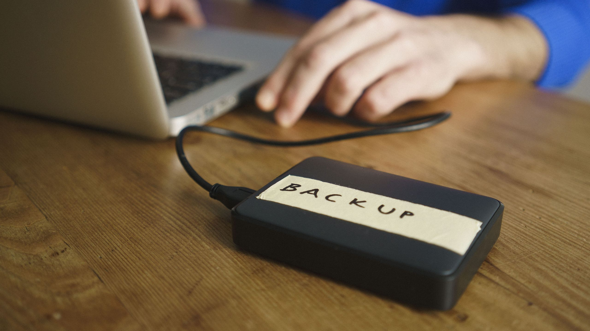
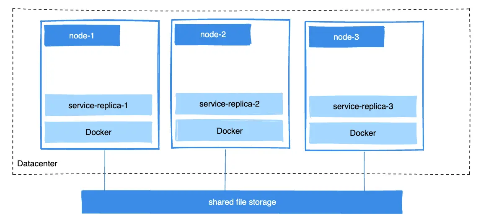
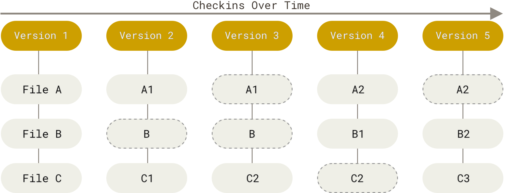

<!-- _class: cover -->

<span class="week">Week 5</span>

# Beveilig, bewaar en herstel je site

Van werkende site naar bewezen herstel.

**Mijlpaal:** volledige kopie en geslaagde hersteltest.

<figure class="visual">

<figcaption>Beeld: <a href="https://www.techradar.com/how-to/how-to-fix-an-external-hard-drive-thats-not-showing-up">Getty Images, via TechRadar</a></figcaption>
</figure>

<!-- Beeldbron: Getty Images, via TechRadar. https://cdn.mos.cms.futurecdn.net/Rpm2WkaSPAH4qevAvhc58-2560-80.jpg. Geraadpleegd op 2026-10-30. Volledige brongegevens: ../assets/slides/BRONNEN.md -->


---


<!-- _class: lesson -->

# Wat je deze week leert

Je maakt de werkende site herstelbaar. Daarvoor moet je weten welke gegevens en bestanden samen nodig zijn.

- Je koppelt beveiligingsmaatregelen aan concrete risico's.
- Je maakt en controleert een database- en bestandskopie en bewaart de juiste codeversie.
- Je herstelt die kopie in een apart Compose-project op poort 8081.
- Je toont dat inhoud, afbeeldingen en functies terugkomen en dat de bron onafhankelijk blijft werken.


---


<!-- _class: lesson -->

# De site bestaat uit meerdere lagen

De browser bereikt WordPress, maar daaronder zitten ook de LXC, Docker, Apache/PHP, MariaDB en opslag. WordPress gebruikt bovendien thema's, plug-ins en gebruikersaccounts.

Elke laag heeft eigen instellingen en onderhoud. Een ontbrekende upload los je bijvoorbeeld niet op door een wachtwoord te wijzigen. Een open databasepoort sluit je in de netwerk- of Compose-configuratie.

Benoem daarom eerst waar het probleem zit en welke laag je maatregel daadwerkelijk beschermt.


---


<!-- _class: compact lesson -->

# Een maatregel kiezen bij een risico

Begin met een concrete vraag: wat kan verloren gaan of misbruikt worden en waardoor?

| Risico | Passende maatregel | Controle |
| --- | --- | --- |
| Een redacteur krijgt te veel toegang | Passende rol kiezen | Verboden actie testen |
| Een update breekt de site | Recente kopie en hertest | Bezoekersroute doorlopen |
| De LXC gaat verloren | Kopie buiten de LXC | Apart herstellen |

Test het gedrag om te controleren of de gekozen maatregel helpt.


---


<!-- _class: lesson -->

# Accounts met passende toegang

Gebruik voor elk testaccount een uniek wachtwoord en bewaar het in een wachtwoordmanager. Deel geen beheerdersaccount om een redactionele taak mogelijk te maken.

Kies de minst ruime rol die de taak ondersteunt en herhaal de roltests uit week 4. Waar passend kun je tweestapsverificatie toevoegen, mits je ook de herstelroute begrijpt.

Omdat de oefensite HTTP gebruikt, blijven dit aparte testaccounts. Gebruik hier geen wachtwoorden die ook voor echte persoonlijke accounts dienen.


---


<!-- _class: lesson -->

# Een update gecontroleerd uitvoeren

Maak eerst een recente, bruikbare kopie en noteer de huidige versies van de onderdelen die je gaat bijwerken.

Werk gericht bij en doorloop daarna Home, catalogus, filter, detailpagina, aanmelding en reactie. Een geslaagde update bewijst op zichzelf niet dat alle functies nog correct samenwerken.

Vind je een probleem, noteer dan welke wijziging eraan voorafging. Je herstelkopie en versiegegevens geven je een route terug naar een bekende werkende toestand.


---


<!-- _class: lesson -->

# Reacties opnieuw testen na een wijziging

Een themawijziging kan het reactieformulier uit een detailtemplate laten verdwijnen. Een plug-inwijziging kan de manier van indienen of modereren beïnvloeden.

Herhaal daarom de volledige test uit week 4: dien een fictieve reactie in, controleer haar status, keur haar goed en bekijk de publieke detailpagina.

Controleer ook of de bedoelde rol nog kan modereren. Zo test je het werkelijke gedrag van de bijgewerkte site en merk je een ontbrekend onderdeel op.


---


<!-- _class: lesson -->

# Wat ziet een beveiligingsplug-in?

Een plug-in draait binnen WordPress en kan bijvoorbeeld aanmeldingen beperken of bepaalde bestanden controleren. Haar bereik hangt af van de gekozen functie en configuratie.

Daarmee controleer je niet automatisch alle instellingen van de LXC, de Docker-poorten of de beschikbaarheid van je herstelkopie.

Noteer daarom welk risico de plug-in helpt beperken en test dat gedrag. Houd daarnaast de controles op accounts, netwerk, updates en back-up als afzonderlijke taken zichtbaar.


---


<!-- _class: compact lesson -->

# Waar staan de sitegegevens?

De herstelkopie combineert gegevens en bestanden uit verschillende plaatsen.

| Opslag | Wat staat erin? | Hoe neem je het mee? |
| --- | --- | --- |
| MariaDB | Inhoud en instellingen | SQL-export |
| WordPress-opslag | Uploads en uitbreidingen | Bestandsarchief |
| Repository | Compose en eigen code | Juiste Git-commit |
| Lokale configuratie | Wachtwoorden in `.env` | Afgeschermd bewaren |

Neem ook eigen bestanden buiten deze standaardindeling mee.


---


<!-- _class: lesson -->

# Ook een back-up bevat gevoelige gegevens

Een ingevuld `.env` bevat databasewachtwoorden. Een SQL-dump kan gebruikersnamen, reacties, instellingen en wachtwoordhashes bevatten.

Behandel beide als afgeschermde bestanden. Zet `.env` en `backups/` in `.gitignore` en beperk de toegang tot de kopieën. Toon de inhoud niet in screenshots of je projectverslag.

Documenteer wel welke onderdelen je bewaart en waar een bevoegde gebruiker ze kan terugvinden. De repository beschrijft de procedure zonder de geheime waarden te publiceren.


---


<!-- _class: visual lesson -->

# Opslag die blijft is nog geen herstelkopie

Een volume houdt gegevens bij wanneer een container vervangen wordt. Gedeelde opslag, zoals in de figuur, kan bovendien wijzigingen voor meerdere gebruikers tegelijk zichtbaar maken.

Verwijdering of beschadiging blijft daarmee ook onderdeel van de actuele opslag. Voor herstel heb je een **afzonderlijk bewaarde kopie van een eerder moment** nodig, liefst buiten de LXC.

<figure class="visual">

<figcaption>Beeld: <a href="https://docs.docker.com/engine/storage/volumes/">Docker, Inc.</a></figcaption>
</figure>

<!-- Beeldbron: Docker, Inc.. https://docs.docker.com/engine/storage/images/volumes-shared-storage.webp. Geraadpleegd op 2026-10-30. Volledige brongegevens: ../assets/slides/BRONNEN.md -->


---


<!-- _class: lesson -->

# Wat ontbreekt in een XML-export?

De WordPress-exportfunctie kan inhoud overdragen naar een andere installatie. Dat is nuttig voor migratie van bepaalde items, maar levert niet vanzelf de volledige werkende site terug.

Thema- en plug-inbestanden, alle instellingen en de werkelijk benodigde uploads zijn daarmee niet automatisch volledig veiliggesteld.

Voor deze opdracht maak je daarom een databasekopie én een kopie van de benodigde bestanden, met de passende eigen code en configuratie. Daarna bewijs je het resultaat door apart te herstellen.


---


<!-- _class: compact lesson -->

# De onderdelen van één herstelbare kopie

| Onderdeel | Wat bewaar je? |
| --- | --- |
| Database | Een consistente SQL-dump |
| Bestanden | Benodigde uploads, thema's en plug-ins |
| Eigen code | De Git-commit die bij de kopie hoort |
| Configuratie | Compose, image-tags en veilig bewaarde instellingen |

Het voorbeeld in de theorie archiveert `wp-content`. Controleer of jij ook aangepaste bestanden buiten die map gebruikt en neem die apart mee. De onderdelen moeten samen dezelfde siteversie reconstrueren.


---


<!-- _class: lesson -->

# Eigen code via bind mounts meenemen

Een **bind mount** koppelt een map uit je project aan een pad in de container. De voorbeeldplug-in uit week 3 kan daardoor rechtstreeks uit `plugins/cursus-catalogus` geladen worden.

Die code komt bij herstel niet vanzelf terug doordat je een named volume hergebruikt of terugzet. Bewaar daarom de bijbehorende repositoryversie en maak de mount in de herstelomgeving opnieuw beschikbaar.

Lees vóór de back-up de `volumes`-regels van je Compose-bestand en noteer welke mappen uit het project komen.


---


<!-- _class: lesson -->

# Database en bestanden bij elkaar laten passen

Plan een kort moment zonder nieuwe uploads, reacties of inhoudswijzigingen. Maak tijdens dat moment de database-export en het bestandsarchief.

Anders kan de database al naar een nieuwe afbeelding verwijzen terwijl die nog niet in je bestandskopie zit, of omgekeerd.

Een transactionele SQL-export helpt bij een consistente databaseweergave. Ze maakt de database- en bestandskopie niet automatisch op exact hetzelfde moment. Daarom beperk je wijzigingen tijdens beide stappen en noteer je wanneer de kopie gemaakt is.


---


<!-- _class: lesson -->

# De database naar SQL exporteren

Maak eerst `backups/` en beperk de maptoegang zoals in de theorie. Voer vanuit de projectmap uit:

```bash
docker compose exec -T db sh -c '
  mariadb-dump --single-transaction \
    -u"$MARIADB_USER" -p"$MARIADB_PASSWORD" \
    "$MARIADB_DATABASE"
' > backups/database.sql
```

De container leest zijn databasegegevens uit de omgeving. De uitvoer wordt op de LXC in `database.sql` opgeslagen. Controleer de exitcode en foutmeldingen; een aangemaakt bestand alleen bewijst geen geslaagde export.


---


<!-- _class: lesson -->

# WordPress-bestanden archiveren

```bash
docker compose exec -T wordpress \
  tar -C /var/www/html -czf - wp-content \
  > backups/wp-content.tar.gz
```

`tar` verzamelt de map `wp-content` met onder meer uploads, thema's en plug-ins. De gecomprimeerde uitvoer gaat naar een archiefbestand op de LXC.

Controleer welke eigen code daarnaast via mounts of andere paden geladen wordt. Bewaar ook die bestanden of hun juiste codeversie. Dit archief vervangt de SQL-dump niet: de inhoud en instellingen zitten in MariaDB.


---


<!-- _class: lesson -->

# Aanwezigheid en integriteit controleren

Controleer of beide bestanden niet leeg zijn en maak een lijst met controlesommen:

```bash
test -s backups/database.sql
test -s backups/wp-content.tar.gz
sha256sum backups/database.sql \
  backups/wp-content.tar.gz > backups/SHA256SUMS
sha256sum -c backups/SHA256SUMS
```

Een **checksum** is een vingerafdruk van de bestandsinhoud. Na kopiëren controleer je of dezelfde bytes aankomen. Dat toont nog niet of WordPress uit die bestanden correct kan herstellen; daarvoor volgt de hersteltest.


---


<!-- _class: visual lesson -->

# De kopie buiten de LXC bewaren

Verlies van de LXC mag niet ook de enige back-up wissen. Bewaar SQL, bestanden en checksums op een toegestane, afgeschermde opslagplek buiten die LXC.

Noteer de Git-commit van de bijbehorende eigen code. De figuur toont zulke codeversies: kies bij herstel de versie die past bij je kopie. Controleer na overdracht opnieuw de checksums.

<figure class="visual">

<figcaption>Beeld: <a href="https://git-scm.com/book/en/v2/Getting-Started-What-is-Git%3F">Scott Chacon en Ben Straub, Pro Git</a></figcaption>
</figure>

<!-- Beeldbron: Scott Chacon en Ben Straub, Pro Git, CC BY-NC-SA 3.0. https://git-scm.com/book/en/v2/images/snapshots.png. Geraadpleegd op 2026-10-30. Volledige brongegevens: ../assets/slides/BRONNEN.md -->


---


<!-- _class: compact lesson -->

# Herstellen in een afzonderlijke omgeving

Maak een aparte testmap met de juiste codeversie, configuratie en gecontroleerde kopie.

| Onderdeel | Bron | Herstelomgeving |
| --- | --- | --- |
| Compose-project | Standaard project | `cursus-herstel` |
| Webpoort | `8080` | `8081` |
| Databasevolume | Bestaand volume | Nieuw testvolume |
| WordPress-volume | Bestaand volume | Nieuw testvolume |

De projectnaam scheidt gewone projectvolumes. Controleer ook vaste namen, externe volumes en mounts voordat je start.


---


<!-- _class: lesson -->

# De herstelkopie op poort 8081

Wijzig in de **testkopie** de webmapping naar `8081:80`. De bron blijft bereikbaar op poort 8080.

```bash
docker compose -p cursus-herstel config --quiet
docker compose -p cursus-herstel up -d
docker compose -p cursus-herstel ps
```

Gebruik bij elke herstelopdracht dezelfde projectnaam en werkmap. Controleer dat de database gereed is voordat je importeert. De aparte webpoort voorkomt een conflict, maar bewijst op zichzelf nog geen afzonderlijke opslag.


---


<!-- _class: lesson -->

# Verborgen gedeelde opslag uitsluiten

Controleer vóór starten het Compose-bestand van de herstelomgeving. Een volume met `external: true` of een vaste gedeelde `name` kan ondanks een andere projectnaam dezelfde opslag gebruiken.

Controleer ook bind mounts. Een schrijfbare mount naar de bronmap kan wijzigingen aan de bron doorgeven.

Gebruik nieuwe testvolumes en een zelfstandige codekopie waar nodig. Leg vast welke mappen of volumes gekoppeld zijn. Bij twijfel onderzoek je eerst de koppelingen voordat je gegevens importeert of wijzigt.


---


<!-- _class: lesson -->

# SQL en bestanden in de testsite herstellen

Voer alle stappen uit in de testmap met `-p cursus-herstel`, zoals uitgewerkt in [de theorie](Ch5-theorie.md#4-herstel-in-een-tweede-compose-project).

1. Start de services en wacht tot MariaDB klaar is.
2. Stop alleen WordPress van het herstelproject.
3. Importeer `database.sql` in de testdatabase met de MariaDB-client.
4. Pak `wp-content.tar.gz` uit in de WordPress-opslag van de testsite.

Controleer elke stap op fouten. Vervang daarna de site-URL's in diezelfde testdatabase voordat je de bezoekersroute controleert.


---


<!-- _class: lesson -->

# URL's vervangen met WP-CLI

De kopie bevat nog bron-URL's met `:8080`. WP-CLI kan die vervangen en daarbij geserialiseerde WordPress-waarden verwerken.

Gebruik de CLI-service uit de theorie, met de **testdatabase en testopslag**:

```bash
docker compose -p cursus-herstel --profile tools \
  run --rm -T cli search-replace \
  'http://<LXC-IP>:8080' 'http://<LXC-IP>:8081' \
  --all-tables-with-prefix --skip-columns=guid --dry-run
```

Vul de werkelijke URL's in. Controleer eerst de dry run; voer daarna dezelfde opdracht zonder `--dry-run` uit. Start vervolgens test-WordPress opnieuw.


---


<!-- _class: lesson -->

# Waarom de kolom `guid` overslaan?

Een **GUID** identificeert een inhoudsitem, onder meer voor toepassingen zoals feeds. De waarde kan op een URL lijken, maar is geen actuele permalink die bij elke verhuizing moet meeveranderen.

Daarom laat de voorbeeldopdracht de kolom `guid` ongemoeid met `--skip-columns=guid`.

Blijven publieke links naar de bron wijzen, onderzoek dan de gebruikte bron-URL, de site-instellingen en eventuele `WP_HOME`- of `WP_SITEURL`-overrides. Wijzig niet zomaar elke URL-achtige waarde in de database.


---


<!-- _class: lesson -->

# Bewijzen dat de herstelde site werkt

Open `http://<LXC-IP>:8081` vanaf een ander toestel. Kies een herkenbaar item en een afbeelding die al vóór de back-up bestonden.

Doorloop Home, catalogus, filter en detailpagina. Meld ook aan met een testaccount en controleer een fictieve reactie.

Zo controleer je database-inhoud, bestanden en functies samen. Een lege WordPress-installatie of een draaiende container is nog geen geslaagd herstel. Noteer per handeling de gebruikte URL en feitelijke uitkomst.


---


<!-- _class: lesson -->

# Werken bron en kopie onafhankelijk?

Maak alleen op de herstelde testsite een onschuldige wijziging, bijvoorbeeld een nieuw conceptbericht met de titel Marker hersteltest.

Open daarna de bron op poort 8080. Die marker hoort daar niet te verschijnen. Controleer ook dat de bestaande broninhoud en bezoekersroute nog werken.

Verschijnt de marker wel op beide sites, stop dan de test en onderzoek gedeelde database, volumes of mounts. Een andere URL alleen garandeert niet dat de gegevens gescheiden zijn.


---


<!-- _class: lesson -->

# Een herstelprocedure die iemand kan volgen

Leg in je README vast wanneer de kopie gemaakt is, welke codecommit en images erbij horen en welke onderdelen je bewaarde.

Beschrijf de afgeschermde opslagplek, testmap, projectnaam, poorten, importstappen en URL-vervanging. Neem de exacte opdrachten op zonder geheime waarden.

Noteer vervolgens testdatum, herkenbaar testitem en uitkomst voor media, login, filter en reactie. Beschrijf ook beperkingen. Zo laat je zien wat werkelijk getest is en welke stappen nodig zijn om het resultaat te herhalen.


---


<!-- _class: question lesson -->

# Kennischeck: een onvolledige zekerheid

Een SQL-dump is niet leeg en de checksum klopt na overdracht. Je maakt daarna de broncontainer opnieuw aan met dezelfde volumes. De site werkt nog.

1. Wat bewijzen de bestandscontroles en de heraanmaak elk?
2. Welke bestanden en code kunnen naast de SQL-dump nodig zijn?
3. Welke aparte proef moet je uitvoeren om herstel uit de kopie aan te tonen?

<!-- Bespreek: aanwezigheid/integriteit en persistentie; uploads, thema's, plug-ins, code en configuratie; afzonderlijk project met nieuwe opslag herstellen en functioneel testen. -->


---


<!-- _class: milestone -->

# Weekmijlpaal

**Afgewerkte site met gedocumenteerde en geteste herstelprocedure.**

Bron: [projectopdracht](../Opdracht/docker/projectopdracht.md)

<!-- Afbeeldingsbronnen bij deze week: ../assets/slides/BRONNEN.md -->
