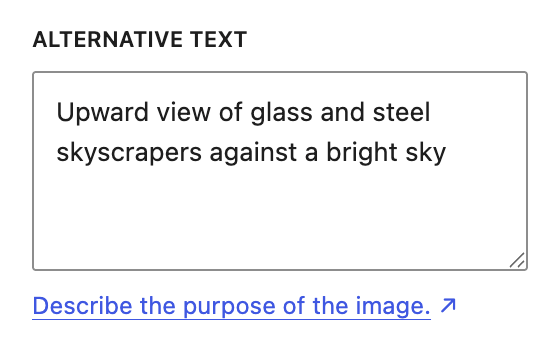
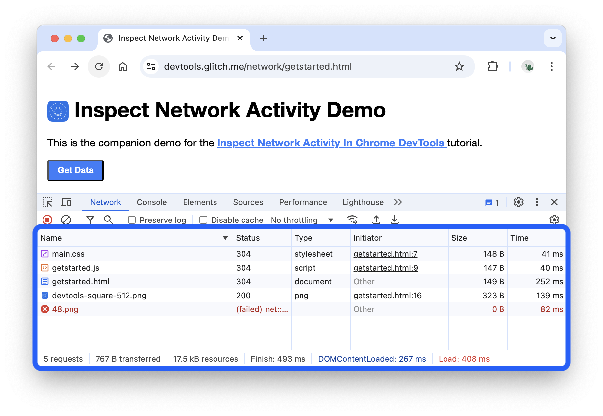
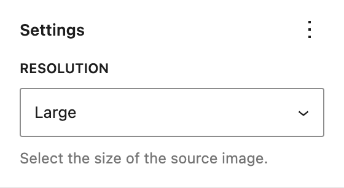
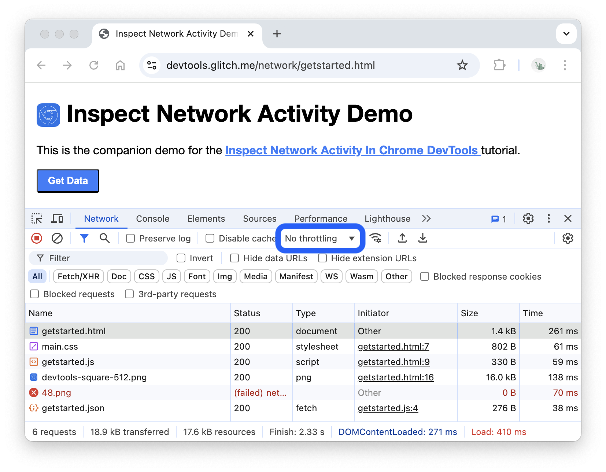
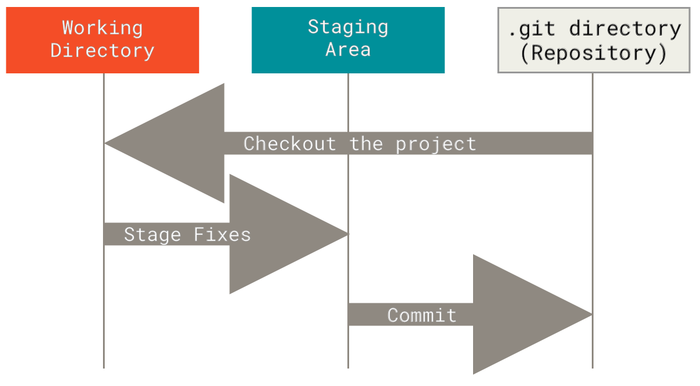

<!-- _class: cover -->

Week 6

# Testen, documenteren en verdedigen

Van projectsite naar uitlegbare oplevering.

**Mijlpaal:** definitieve site en individuele demonstratie.

<figure class="visual">

<figcaption>Beeld: <a href="https://store.steampowered.com/app/504230/">Celeste, Maddy Makes Games, via Steam</a></figcaption>
</figure>

<!-- Beeldbron: Celeste, Maddy Makes Games, via Steam. https://shared.akamai.steamstatic.com/store_item_assets/steam/apps/504230/library_600x900.jpg. Geraadpleegd op 2026-10-30. Volledige brongegevens: ../assets/slides/BRONNEN.md -->

---

<!-- _class: lesson -->

# Wat je deze week leert

Je controleert het project als geheel en maakt zichtbaar hoe iemand het gebruikt, beheert en herstelt.

- Je test de volledige bezoekersroute op meerdere schermen en met toetsenbord.
- Je onderzoekt één concreet probleem en vergelijkt het resultaat na een verbetering.
- Je documenteert start, inhoudsmodel, functies en herstel zonder geheimen te publiceren.
- Je oefent de individuele demonstratie met echte handelingen en herkenbare testgegevens.

Gebruik de projectopdracht als controlelijst voor de definitieve oplevering.

---

<!-- _class: lesson -->

# Eén volledige bezoekersroute doorlopen

Begin in een privévenster op Home. Open de catalogus, kies een genre of zoekterm, open een passend item en dien een fictieve reactie in.

Controleer bij elke stap of duidelijk is waar je bent en wat je daarna kunt doen. Ga ook terug van de detailpagina naar de lijst.

Noteer URL, verwachting en uitkomst. Losse screenshots van de afzonderlijke schermen tonen niet of de verbindingen tussen die schermen werken.

---

<!-- _class: visual lesson -->

# Dezelfde taak op drie schermgroottes

Test Home, catalogus en detail op smartphone, tablet en desktop. Gebruik echte titels, afbeeldingen en formulieren.

Controleer of het menu bereikbaar is, tekst binnen beeld blijft en filters bruikbaar zijn. Op het mobiele voorbeeld staat inhoud onder elkaar; de bezoeker moet nog steeds kunnen doorklikken.

Noteer per scherm een concrete uitkomst in plaats van alleen een algemene bevestiging.

<figure class="visual">

<figcaption>Beeld: <a href="../Opdracht/docker/README.md">Eigen cursusvoorbeeld PixelAtlas. Gamebeelden: oorspronkelijke makers, via Steam</a></figcaption>
</figure>

<!-- Beeldbron: Eigen cursusvoorbeeld PixelAtlas. Gamebeelden: oorspronkelijke makers, via Steam. ../../Opdracht/docker/README.md. Geraadpleegd op 2026-10-30. Volledige brongegevens: ../assets/slides/BRONNEN.md -->

---

<!-- _class: lesson -->

# Een positieve test vooraf beschrijven

Kies een item waarvan je zeker weet dat het aan de selectie voldoet. De fictieve Maanpuzzel heeft bijvoorbeeld de term Puzzel.

Noteer als verwachting: na kiezen van Puzzel verschijnt Maanpuzzel en opent de titel de juiste detailpagina. Controleer daar ook de opgeslagen kenmerken.

Voer de test uit en schrijf het feitelijke resultaat op. Zo kan je na een wijziging dezelfde handeling herhalen en beoordelen of de functie nog correct werkt.

---

<!-- _class: lesson -->

# Uitsluitingen en lege uitkomsten testen

Controleer ook wat niet mag verschijnen. Een game met uitsluitend Strategie hoort bijvoorbeeld niet onder Puzzel.

Zoek daarna naar een woord dat geen enkel item bevat. Verwacht een begrijpelijke melding en een bruikbare terugweg naar de catalogus.

Deze **negatieve tests** vinden fouten die een gewone treffer niet blootlegt: een te brede query kan jouw gewenste item tonen terwijl de volledige selectie toch verkeerd is.

---

<!-- _class: lesson -->

# Naar welke omgeving wijzen de links?

Doorloop de publieke route vanaf het tweede toestel en bekijk de adressen na elke klik. Ze moeten bij de bedoelde LXC en bronpoort 8080 blijven.

Een link naar `localhost` verwijst op dat toestel naar zichzelf. Een link naar `:8081` kan onbedoeld de herstelkopie openen.

Controleer navigatie, afbeeldingen en links in de inhoud. Gebruik bij herstel de WordPress-geschikte URL-vervanging uit week 5 en test na zo'n wijziging opnieuw.

---

<!-- _class: lesson -->

# De taak met alleen het toetsenbord

Doorloop het menu en de catalogus met **Tab**, ga terug met **Shift+Tab** en open links met **Enter**. Test ook de filterbediening en het reactieformulier.

Je moet steeds zien welk element focus heeft. De volgorde moet aansluiten op de inhoud en je mag niet vastlopen in een onderdeel.

Noteer waar de route faalt. Een screenshot van een zichtbare knop bewijst niet dat je die zonder muis kunt bereiken of activeren.

---

<!-- _class: lesson -->

# Koppen geven de pagina structuur

Een H1 benoemt normaal het onderwerp van de pagina. Tussenkoppen zoals H2 verdelen de tekst in herkenbare onderdelen; onderliggende koppen werken een onderdeel verder uit.

Gebruik een kopblok dus voor betekenis, niet alleen om tekst groter te maken. Het thema kan de paginatitel al als H1 tonen.

Controleer de gerenderde HTML met de browserinspecteur. Vergelijk de koppen met de zichtbare inhoud: beschrijven ze werkelijk wat in het volgende deel staat?

---

<!-- _class: visual lesson -->

# Alt-tekst beschrijft de betekenis hier

Een alt-tekst geeft een tekstalternatief voor betekenisvol beeld. Beschrijf wat de afbeelding in deze context toevoegt.

Bij een screenshot dat een filter uitlegt, kan dat de gekozen term en zichtbare uitkomst zijn. Een decoratief beeld hoeft de omliggende tekst niet te herhalen.

Controleer de daadwerkelijke afbeelding én haar functie; alleen een ingevuld veld bewijst nog geen bruikbare beschrijving.

<figure class="visual">

<figcaption>Beeld: <a href="https://wordpress.org/documentation/article/image-block/">WordPress.org</a></figcaption>
</figure>

<!-- Beeldbron: WordPress.org, documentatiebijdragers. https://wordpress.org/documentation/files/2026/08/image-block-alternative-text-field.png. Geraadpleegd op 2026-10-30. Volledige brongegevens: ../assets/slides/BRONNEN.md -->

---

<!-- _class: lesson -->

# Een formulier houdt zijn labels zichtbaar

Een **label** benoemt het invoerveld, bijvoorbeeld Naam of Reactie. Een **placeholder** geeft een voorbeeld binnen het lege veld en verdwijnt zodra iemand typt.

Gebruik daarom een blijvend, correct gekoppeld label. De bezoeker moet tijdens het invullen kunnen herkennen wat gevraagd wordt.

Test het reactieformulier met toetsenbord en fictieve gegevens. Controleer ook wat er gebeurt bij een leeg verplicht veld: de foutmelding moet helpen om gericht te corrigeren.

---

<!-- _class: lesson -->

# Wat automatische controles wel en niet zien

Een automatische controle kan bijvoorbeeld ontbrekende alternatieve teksten of bepaalde contrastproblemen signaleren. Ze begrijpt niet vanzelf of jouw tekst het juiste beeld uitlegt of dat de bezoekersroute logisch is.

Combineer de gevonden meldingen daarom met een handmatige taaktest, toetsenbordcontrole en inhoudelijke beoordeling.

Gebruik gereedschap in een browser die de LXC kan bereiken. Een externe dienst kan het interne adres meestal niet ophalen; een mislukte externe scan bewijst dan geen fout in de pagina zelf.

---

<!-- _class: lesson -->

# Vindbare inhoud beantwoordt een vraag

Neem een concrete vraag zoals welke puzzelgame je met twee personen kunt spelen. Bedenk welke pagina daar een bruikbaar antwoord op geeft.

Schrijf een duidelijke titel en uitleg, toon passende kenmerken en link naar relevante items. Daarmee help je bezoekers de juiste inhoud herkennen en bereiken.

Dat vormt ook een inhoudelijke basis voor SEO, oftewel zoekmachineoptimalisatie. Op deze interne oefensite beoordeel je de kwaliteit van de inhoud en structuur, zonder publieke ranking te claimen.

---

<!-- _class: lesson -->

# Titel, URL en linktekst laten samenwerken

Een detailpagina moet herkenbaar over hetzelfde item gaan in de paginatitel, zichtbare kop en inhoud. De URL helpt de bestemming begrijpen.

Gebruik op een andere pagina een linktekst die die bestemming benoemt, bijvoorbeeld **Lees de uitleg bij Maanpuzzel**.

Controleer de publieke uitvoer. Alleen een titelveld invullen in WordPress bewijst niet welke HTML-titel het thema toont. Klik de link ook werkelijk aan en kijk of de juiste pagina opent.

---

<!-- _class: lesson -->

# Samenvatting en metabeschrijving onderscheiden

Een **excerpt** is een inhoudelijke samenvatting die een thema bijvoorbeeld in kaarten of lijsten kan gebruiken. Het is niet automatisch de metabeschrijving in de HTML van de detailpagina.

Een **metabeschrijving** kan door je thema of een gerichte SEO-oplossing worden toegevoegd. Controleer in de broncode wat werkelijk wordt uitgevoerd.

Vul metadata in met een inhoudelijk doel. Een ingevuld veld of gunstige plug-inscore is geen bewijs dat de bezoeker of HTML de juiste beschrijving ontvangt.

---

<!-- _class: lesson -->

# Een interne site en publieke zoekmachines

De LXC is alleen bereikbaar binnen het opleidingsnetwerk. Een publieke zoekmachine kan de site daardoor niet zomaar bezoeken.

Je kunt wel titels, inhoud, linkstructuur en eventuele metadata beoordelen. Je kunt hiermee geen daadwerkelijke Google-ranking of rich result voor deze interne site aantonen.

Beschrijf in je verslag dus wat je echt controleerde: bijvoorbeeld de HTML-titel en bereikbare catalogusroute. Een domein en publieke zoekprestaties zijn geen verborgen vereiste voor deze opdracht.

---

<!-- _class: lesson -->

# Wat biedt een sitemap?

Een sitemap bevat URL's die een site aan zoekmachines kan aanbieden. Controleer op je eigen installatie of bijvoorbeeld `/wp-sitemap.xml` beschikbaar is en welke inhoud erin staat.

Die lijst dwingt geen bezoek of indexering af. De pagina's moeten ook bereikbaar en geschikt voor verwerking zijn; onze LXC blijft intern.

Verwar vindbaarheid bovendien niet met beveiliging. Een URL uit een lijst weglaten beschermt haar inhoud niet tegen iemand die het adres kent.

---

<!-- _class: visual lesson -->

# Een concrete vertraging onderzoeken

Open de site in een browser die de LXC bereikt en bekijk het **Network-paneel** van de ontwikkelaarstools.

Herlaad dezelfde pagina en kijk welke bestanden veel overdracht of tijd vragen. Een grote cover kan bijvoorbeeld opvallen tussen kleinere bestanden.

Noteer de pagina en meetomstandigheden voordat je iets wijzigt. De screenshot toont het soort netwerkoverzicht dat je hiervoor gebruikt.

<figure class="visual">

<figcaption>Beeld: <a href="https://developer.chrome.com/docs/devtools/network/">Google, Chrome for Developers</a></figcaption>
</figure>

<!-- Beeldbron: Google, Chrome for Developers, CC BY 4.0. https://developer.chrome.com/static/docs/devtools/network/image/the-network-log.png. Geraadpleegd op 2026-10-30. Volledige brongegevens: ../assets/slides/BRONNEN.md -->

---

<!-- _class: lesson -->

# De verbetering kiezen op basis van bewijs

Kies een probleem dat je werkelijk waarnam. Een cover van meerdere megabytes op een kleine kaart is bijvoorbeeld een concreter vertrekpunt dan een algemene wens voor een snellere site.

Pas één gerichte ingreep toe en test opnieuw. Controleer ook of het betrokken onderdeel zijn functie behoudt.

Schakel een plug-in niet blind uit omdat ze tijd kost: ze kan het verplichte filter of de interactie leveren. Koppel elke ingreep aan het probleem en het gewenste resultaat.

---

<!-- _class: visual lesson -->

# Passende afbeeldingsbestanden

Een kleine kaart heeft meestal geen origineel van duizenden pixels nodig. Kies passende afmetingen en compressie waarbij het beeld duidelijk blijft.

Controleer in het blok of thema welke afbeeldingsgrootte daadwerkelijk gebruikt wordt.

Vergelijk de kwaliteit op klein en groot scherm en behoud de alt-tekst.

<figure class="visual">

<figcaption>Beeld: <a href="https://wordpress.org/documentation/article/image-block/">WordPress.org</a></figcaption>
</figure>

<!-- Beeldbron: WordPress.org, documentatiebijdragers. https://wordpress.org/documentation/files/2026/08/image-block-resolution.png. Geraadpleegd op 2026-10-30. Volledige brongegevens: ../assets/slides/BRONNEN.md -->

---

<!-- _class: lesson -->

# Cache testen op actuele inhoud

Een cache bewaart een eerder resultaat zodat de site dat sneller opnieuw kan leveren. Dat kan nuttig zijn, maar veranderlijke pagina's vragen extra controle.

Wijzig een filterkeuze en dien een fictieve reactie in. Controleer of resultaten en goedgekeurde reacties op het juiste moment veranderen. Test ook aanmelden en afmelden.

Krijgt een bezoeker een verouderde of verkeerde pagina, onderzoek dan wat gecachet wordt. Na een prestatie-ingreep moeten de functionele taken nog correct werken.

---

<!-- _class: visual lesson -->

# Eerlijk vóór en na vergelijken

Gebruik dezelfde pagina, hetzelfde toestel en dezelfde netwerk- en cache-instellingen voor beide metingen. Verander anders niet ongemerkt meerdere omstandigheden tegelijk.

Noteer het oorspronkelijke probleem, je ingreep en het waargenomen verschil. Controleer daarna ook de bezoekersfunctie.

Een snellere laadtijd is pas bruikbaar bewijs wanneer het beeld leesbaar blijft en de route nog werkt.

<figure class="visual">

<figcaption>Beeld: <a href="https://developer.chrome.com/docs/devtools/network/">Google, Chrome for Developers</a></figcaption>
</figure>

<!-- Beeldbron: Google, Chrome for Developers, CC BY 4.0. https://developer.chrome.com/static/docs/devtools/network/image/enable-throttling.png. Geraadpleegd op 2026-10-30. Volledige brongegevens: ../assets/slides/BRONNEN.md -->

---

<!-- _class: visual lesson -->

# Wat zet je in de repository?

Bewaar `compose.yaml`, `.env.example`, `.gitignore`, eigen code en de README in Git. Een commit legt een herkenbare codeversie vast, zoals in de figuur.

Items, reacties en sommige instellingen ontstaan in de database. Uploads zijn bestanden. Die komen niet vanzelf mee door alleen code te committen.

Verbind daarom de repositoryversie met de herstelkopie uit week 5.

<figure class="visual">

<figcaption>Beeld: <a href="https://git-scm.com/book/en/v2/Getting-Started-What-is-Git%3F">Scott Chacon en Ben Straub, Pro Git</a></figcaption>
</figure>

<!-- Beeldbron: Scott Chacon en Ben Straub, Pro Git, CC BY-NC-SA 3.0. https://git-scm.com/book/en/v2/images/areas.png. Geraadpleegd op 2026-10-30. Volledige brongegevens: ../assets/slides/BRONNEN.md -->

---

<!-- _class: lesson -->

# Het inhoudsmodel in de README uitleggen

Beschrijf voor wie de site bedoeld is en welke taak de bezoeker kan uitvoeren. Benoem daarna het CPT, de velden en de gebruikte taxonomieën of categorieën.

Geef voorbeeldwaarden en leg uit waar ze publiek verschijnen. Vermeld de tien uitgewerkte items, de vindroute en hoe interactie en moderatie werken.

Voeg de rollenmatrix met echte testresultaten toe. Zo begrijpt een lezer zowel de gegevens als de handelingen die de site erop mogelijk maakt.

---

<!-- _class: lesson -->

# Opstarten én herstellen documenteren

De README moet uitleggen vanuit welke map je Compose start, welke configuratie nodig is en op welke URL de site bereikbaar wordt.

Beschrijf ook hoe SQL, bestanden, codeversie en afgeschermde instellingen weer samenkomen. Noteer de aparte projectnaam en poort voor de hersteltest.

Verwijs naar de bewaarde kopie zonder geheimen te publiceren. Voeg testdatum en resultaten toe, zodat een lezer kan onderscheiden welke procedure beschreven is en welke daadwerkelijk werd uitgevoerd.

---

<!-- _class: lesson -->

# De repository op geheimen controleren

Controleer vóór oplevering welke bestanden je gaat delen. Een ingevulde `.env`, databasekopie met persoonsgegevens en herstelcodes horen niet in Git.

`.env.example` bevat alleen invulwaarden en `backups/` staat in `.gitignore`. Een ignore-regel verwijdert een eerder gevolgd bestand niet automatisch uit Git.

Is een echt geheim toch gedeeld, verwijder het dan niet alleen uit de nieuwste tekst: vervang ook het betrokken geheim en bespreek de juiste herstelactie voor de repository.

---

<!-- _class: lesson -->

# De bezoekersdemonstratie oefenen

Open de site vanaf een tweede toestel en begin zoals een nieuwe bezoeker op Home. Vind een passend item via zoeken of filteren en open de details.

Toon de kenmerken, de terugweg en een werkende interactie met je moderatiekeuze. Laat dezelfde route ook op een klein scherm zien.

Gebruik herkenbare testitems, zodat je kunt uitleggen waarom een resultaat klopt. Oefen de volgorde zonder aanwijzingen van iemand die weet waar elke knop staat.

---

<!-- _class: lesson -->

# De beheerdemonstratie oefenen

Meld aan met je twee testrollen en toon hun relevante toegestane en geweigerde handelingen. Wijs daarna Compose-services, webpoort, databaseverbinding en opslag aan.

Leg uit wat een heraanmaak met dezelfde volumes bewijst en open ook je afzonderlijk herstelde kopie of toon controleerbaar herstelbewijs.

Toon ten slotte je eigen CSS en één onderbouwde verbetering. Gebruik de README als overzicht, zodat je elke keuze met code, instellingen of een uitgevoerde test kunt verbinden.

---

<!-- _class: question lesson -->

# Kennischeck: wat kun je reconstrueren?

Je repository bevat Compose, je eigen thema en de catalogusplug-in. De tien items, uploads en reacties werden via WordPress ingevoerd. Alleen de containers zijn al eens herstart.

1. Welke onderdelen ontbreken om de ingerichte site na verlies terug te krijgen?
2. Welke proef toont aan dat je kopie herstelbaar is?
3. Hoe bewijst je demonstratie dat het filter ook verkeerde items uitsluit?

<!-- Bespreek: SQL, benodigde bestanden en afgeschermde configuratie; herstel in apart project met nieuwe opslag en functionele controle; vooraf een uitsluitend anders ingedeeld testitem kiezen. -->

---

<!-- _class: milestone -->

# Weekmijlpaal

**Definitieve oplevering: werkende site, reproduceerbare documentatie en zelfstandige demonstratie.**

Bron: [projectopdracht](../Opdracht/docker/projectopdracht.md)

<!-- Afbeeldingsbronnen bij deze week: ../assets/slides/BRONNEN.md -->
